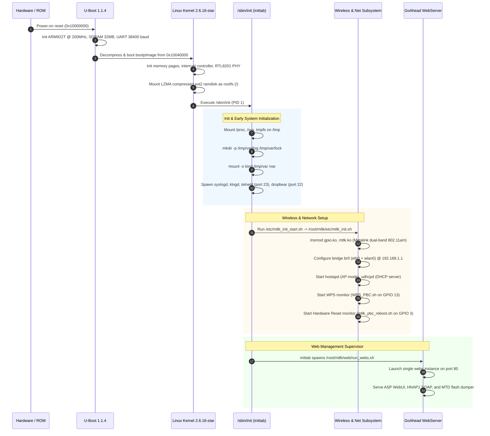
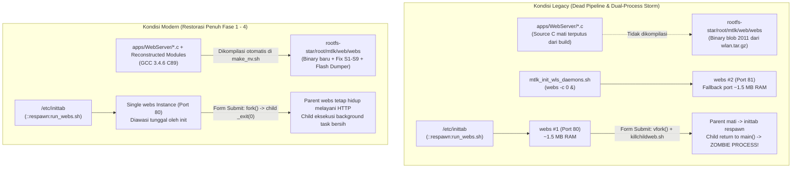

# 📡 WAP610N Project Rules, Invariants & Master Engineering Specification

Master operational directives, architecture blueprints, subsystem audit logs, and development guidelines for the **Cisco Linksys WAP610N / WET610N Firmware Restoration & BSP Engine**.

---

## 1. 🔒 Strict Operational Directives & Invariants

Master rules that **MUST ALWAYS BE FOLLOWED WITHOUT EXCEPTION** by any AI coding agent or developer working on this codebase:

### 1.1 🔒 Strict Workspace & Path Boundaries
- **Workspace Confinement**: Restrict all read, write, search, and execution commands strictly to the project root directory (`./` or `/workspaces/wap610n` / `/home/satszz/wap610n`).
- **Forbidden Paths**: NEVER access, inspect, or reference `/home/satszz/sdcard/` or any directory outside the repository root.
- **Path Portability Invariant**: NEVER introduce local host absolute paths (e.g., `/home/satszz/...`, `/root/...`) into Makefiles, `.config`, header files, or shell scripts. Always enforce relative paths (e.g., `CONFIG_PREFIX="../../rootfs-star"`).

### 1.2 ⚡ GCC 3.4.6 & Ancient Kernel (2.6.16) Toolchain Discipline
- **Legacy C Dialect**: Target compiler is **GCC 3.4.6 (ARM uClibc)**.
  - DO NOT use modern C standards (C99/C11 features like variable declarations inside `for` loops, GNU C extensions from modern GCC, etc.). Code must strictly comply with C89 / GNU89 syntax.
  - DO NOT replace legacy macros or refactor working legacy syntax to "modern best practices".
- **Binary Compatibility**:
  - The Metalink wireless driver (`mtlk.ko`) and proprietary modules rely on exact kernel struct layouts and exported symbols from Linux 2.6.16-star.
  - DO NOT modify core kernel headers or struct definitions (`include/linux/skbuff.h`, netdevice structs, etc.) that could alter binary alignment or ABI for proprietary `.ko` blobs.

### 1.3 💾 Physical Flash (4 MB) & RAM (32 MB) Budget Guardrails
- **Hard Flash Partition Limit**:
  - The maximum allowable size for `bootpImage` / `WAP610N_v1.0.05.bin` is **3.625 MB (3,801,088 bytes)**.
  - Any build exceeding this limit **WILL CORRUPT NVRAM / CONFIGFS PARTITIONS (`0x103E0000`) AND PERMANENTLY BRICK HARDWARE**.
  - Always verify binary size before proposing or committing userspace additions.
- **RAM Footprint (32 MB)**:
  - Do not introduce memory-hungry daemons. All new utilities must be lightweight applets compiled against **uClibc** (strip all debug symbols with `arm-linux-uclibc-strip`).
  - Temporary files and runtime logs must strictly use `/tmp` (`tmpfs`), never writing frequently to physical flash sectors.

### 1.4 🛠️ CI-First Build Workflow
- **No Heavy Local Compilation**: Do not attempt full local kernel toolchain builds unless explicitly requested by the user.
- **Validation Before Commit**:
  - Check `git diff` carefully before staging changes.
  - Ensure changes do not break the Docker build engine (`docker/Dockerfile`, `docker/compile.sh`, and `.github/workflows/compile.yml`).
- **Clean Commit & Push**: Commit with clear, descriptive commit messages documenting modified subsystem(s), then push to GitHub (`satrianaliqa/wap610n`) to let GitHub Actions CI do the heavy lifting.

### 1.5 🛡️ OEM Feature & Hardware Integrity
- **Core Functionality Preservation**:
  - Maintain all stock Access Point capabilities: Dual-Band (2.4 GHz / 5 GHz), WPA2-PSK/Enterprise, WPS PushButton (GPIO 13), Hardware Reset (GPIO 3), WMM QoS, and Ethernet PHY (`RTL8201CP`).
- **Custom Enhancements Continuity**:
  - Preserve integrated enhancements: **Dropbear SSH (Port 22)**, **Telnet (Port 23)**, **Custom Web GUI MTD Flash Dumper**, and memory sysctl tunings.

---

## 2. 🏗️ Hardware Architecture & Pinout Specification

```
┌─────────────────────────────────────────────────────────────────────────┐
│                          CISCO LINKSYS WAP610N                          │
├─────────────────────────────────────────────────────────────────────────┤
│  ┌─────────────────────────────────────────────────────────────────┐    │
│  │  Cavium / Star Semiconductor STR8132 (CNS2132) SoC              │    │
│  │  • ARM922T Core @ 200 MHz (ARMv4T instruction set)              │    │
│  │  • 32 MB SDRAM Memory Space (0x00000000 - 0x02000000)           │    │
│  │  • 4 MB Parallel Flash Memory (0x10000000 - 0x10400000)         │    │
│  └─────────────────────────────────────────────────────────────────┘    │
│                         │                                               │
│  ┌────────────────┬─────┴───────────────┬─────────────────┐             │
│  │                │                     │                 │             │
│  ▼                ▼                     ▼                 ▼             │
│┌───────────────┐┌───────────────────┐ ┌────────────────┐┌──────────────┐│
││  Flash ROM    ││ Ethernet PHY      │ │ Wireless Radio ││ UART Console ││
││  EON          ││ Realtek RTL8201CP │ │ Metalink (MTLK)││ 38400 baud,  ││
││  EN29LV320BB  ││ 10/100 Mbps BaseT │ │ 802.11a/b/g/n  ││ 8N1, 3.3V    ││
││  4 MB Flash   ││ MII Interface     │ │ Dual-Band 2.4/5││ Pin Header   ││
│└───────────────┘└───────────────────┘ └────────────────┘└──────────────┘│
│                                                                         │
│  Hardware GPIO Lines:                                                   │
│  • GPIO 13: WPS PushButton (Active Low, read via /dev/gpio13)           │
│  • GPIO 3:  Hardware Reset Button (Active Low, hold 3s for factory reset│
│  • GPIO 0:  Power/Status LED (Green / Amber solid/blink)                │
│  • GPIO 2:  WPS Status LED (Blue / Amber solid/blink)                   │
└─────────────────────────────────────────────────────────────────────────┘
```

### Hardware Pinout & GPIO Matrix

| Line | Hardware Function | Active Level | Default State | Sysfs / Device Path | Handler Daemon |
|---|---|---|---|---|---|
| **GPIO 13** | WPS PushButton | Active Low (0) | Pulled-up High (1) | `/dev/gpio13` | `/root/mtlk/etc/WPS_PBC.sh` |
| **GPIO 3** | Hardware Reset Button | Active Low (0) | Pulled-up High (1) | `/dev/gpio3` | `/root/mtlk/etc/mtlk_pbc_reboot.sh` |
| **GPIO 0** | Power / Diagnostic LED | Output | Green (Normal) | `/dev/led0` | `mtlk_init.sh` (`echo green > /dev/led0`) |
| **GPIO 2** | WPS Activity LED | Output | Off | Driver controlled | `mtlk_wps_msgloop.tcl` |
| **UART0** | Serial Debug Console | 3.3V TTL | 38400 8N1 | `/dev/ttyS0` | `/etc/inittab` (`ttyS0::respawn:/bin/sh`) |
| **MII** | Realtek RTL8201CP | 100BASE-TX | Auto-MDIX | `eth0` | `ifconfig eth0 192.168.1.1` |

---

## 3. 💾 Flash Memory Partitioning & MTD Map

Physical 4 MB NOR Flash layout (`0x10000000` – `0x10400000`):

```
0x10000000 ┌──────────────────────────────────────────────┐
           │ mtdblock1: U-Boot 1.1.4 Bootloader (128 KB)  │  [READ ONLY]
0x10020000 ├──────────────────────────────────────────────┤
           │ mtdblock3: U-Boot Environment / NVRAM (64 KB)│  [RW: CRC-checked]
0x10030000 ├──────────────────────────────────────────────┤
           │ Reserved Partition / Board Parameters (64 KB)│  [READ ONLY]
0x10040000 ├──────────────────────────────────────────────┤
           │ mtdblock2: Kernel + Ramdisk LZMA             │  [RW: Firmware]
           │ Filename: bootpImage / WAP610N_v1.0.05.bin   │
           │ MAXIMUM PERMISSIBLE SIZE: 3,801,088 BYTES    │
           │ (Exact Budget: 3.625 MB)                     │
0x103E0000 ├──────────────────────────────────────────────┤
           │ mtdblock4: Runtime Configuration File System │  [RW: ConfigFS/JFFS2]
           │ Storage for config.tar.gz / sys.conf         │
0x10400000 └──────────────────────────────────────────────┘
```

> [!CAUTION]
> **Hard Limit Warning**:
> If the compiled `bootpImage` exceeds **3,801,088 bytes**, writing the image will overwrite the starting sector of `mtdblock4` (`0x103E0000`). This corrupts persistent settings and the NVRAM environment, causing an irrecoverable hardware bootloop. The build script `docker/verify-firmware.sh` enforces this size gate with a hard fail.

---

## 4. 📁 Repository Layout & Subsystem Matrix

```
/workspaces/wap610n/
├── 📄 Makefile                     [Top-level build orchestrator]
├── 📄 make_nv.sh                   [Platform build script: reconf/build/clean]
├── 📄 net_ver.cm                   [Historical SVN manifest]
├── 📄 AGENTS.md                    [Master Specification & Engineering Directives]
├── 📄 README.md                    [Public project documentation & flash guide]
│
├── 📁 apps/                        [User-space applications & daemons]
│   ├── busybox-1.8.1/              ├→ Core shell, utilities & lightweight daemons (udhcpd, telnetd)
│   ├── dropbear-0.52/              ├→ Secure SSH daemon (port 22)
│   ├── WebServer/                  ├→ GoAhead HTTP web daemon (port 80) + ASP engine
│   ├── gpio_driver/                ├→ Linux kernel module for GPIO button and LED control
│   ├── wpa_supplicant-0.5/         ├→ Wi-Fi Protected Access authenticator
│   ├── openssl-0.9.8a/             ├→ SSL/TLS cryptography library
│   ├── hnap_wps_status_monitor/    ├→ Background daemon reporting WPS session states
│   ├── Intel-WPS/                  ├→ Wi-Fi Protected Setup state machine
│   ├── mtlk_vb_upnpd/              ├→ UPnP / AV Media Server daemon
│   ├── tinytcl/                    ├→ Lightweight Tcl interpreter for network config scripts
│   ├── force_ethpc_renew_ip/       ├→ Ethernet DHCP renewal helper
│   ├── simpdiff/                   ├→ Fast config comparison applet
│   └── set_env_param/              ├→ U-Boot environment parameter writer
│
├── 📁 kernel/                      [Linux kernel 2.6.16-star source]
│   └── linux-2.6.16-star/
│       ├── arch/arm/               ├→ ARM922T architecture support (Cavium STR8132)
│       ├── drivers/mtlk/           ├→ Metalink wireless driver framework
│       ├── drivers/net/            ├→ Realtek RTL8201CP fast ethernet MAC/PHY driver
│       └── include/linux/          ├→ Frozen kernel headers (Preserve struct alignment!)
│
├── 📁 boards/                      [Board Support Package (BSP)]
│   └── star-6.7.2-mtlk-U-Media-vela/
│       ├── kernel/.config          ├→ Production kernel build configuration
│       └── busybox/.config         ├→ BusyBox applet configuration
│
├── 📁 rootfs/                      [Root filesystem base template]
├── 📁 rootfs-star/                 [Pre-built source-of-truth root filesystem template]
│   ├── etc/                        ├→ Inittab, udhcpc scripts, hostname, network templates
│   └── root/mtlk/                  ├→ Metalink wireless scripts, web UI assets, firmware binaries
│
├── 📁 u-boot-1.1.4/                [U-Boot 1.1.4 bootloader source tree]
├── 📁 tools/                       [Precompiled cross-compilation toolchains]
│   └── arm-uclibc-3.4.6/           ├→ GCC 3.4.6, uClibc, binutils for ARMv4T
│
├── 📁 docker/                      [Reproducible container build engine]
│   ├── Dockerfile                  ├→ Debian 8 (i386) container image definition
│   ├── compile.sh                  ├→ Container entry point & firmware pipeline runner
│   └── verify-firmware.sh          ├→ Strict automated firmware QA & size gatekeeper
│
├── 📁 .github/workflows/           [CI/CD automation pipeline]
│   └── compile.yml                 ├→ GitHub Actions workflow for automated firmware builds
│
├── 📁 devscripts/                  [Build automation & developer tools]
│   ├── validate-build-prerequisites.sh ├→ Pre-flight environment sanity checks
│   ├── net-ver-mkrootfs.sh         ├→ Rootfs assembler & overlay builder
│   └── select-star.sh              ├→ BSP platform selector
│
└── 📁 config/                      [Version & product configurations]
    └── WAP610N_VERSION             ├→ Semantic version configuration file
```

---

## 5. 🔄 Boot Sequence & Daemon Architecture



---

## 6. ⚙️ Build System & Container Pipeline Engineering

### 6.1 Containerized Build Flow (`docker/Dockerfile` & `docker/compile.sh`)
- Builds run in a dedicated **32-bit Debian 8 (Jessie i386)** Docker environment to match GCC 3.4.6 host requirements.
- Sudoers configuration inside Docker is strictly idempotent:
  ```bash
  grep -q "NOPASSWD: ALL" /etc/sudoers || echo "$USER ALL=(ALL) NOPASSWD: ALL" >> /etc/sudoers
  ```
- Workspace directory `rootfs/` is isolated cleanly from `rootfs-star/`. `compile.sh` uses `cp -a rootfs-star rootfs` rather than symlinking to prevent clean rules from wiping the reference source tree.

### 6.2 Pre-Build Validation Suite (`devscripts/validate-build-prerequisites.sh`)
Runs before any compilation begins (fail-fast principle):
1. **Archive integrity**: Verifies `wlan.tar.gz` and `rootfs-star.tgz`.
2. **Directory validation**: Verifies presence of `kernel/`, `apps/`, `boards/`, `tools/`.
3. **Toolchain check**: Validates `arm-linux-uclibc-gcc` (3.4.6) executable and libraries.
4. **Output directories**: Automatically creates `output/` and scratch staging areas.

### 6.3 Fail-Fast Make Orchestration (`devscripts/make_nv.sh`)
- Enforces `set -o pipefail` so that compilation failures hidden behind pipes (`make 2>&1 | tee ...`) correctly propagate non-zero exit codes.
- Explicit `exit 1` statements replace ambiguous bare exits across all configuration routines.
- `apps/scripts/Makefile.MTLK` enforces strict `|| exit 1` error termination in applet build loops.

### 6.4 Dynamic Versioning
Firmware versioning is decoupled from hardcoded strings and read dynamically from `config/WAP610N_VERSION`:
```bash
VERSION=$(grep FIRMWARE_VERSION config/WAP610N_VERSION | cut -d'"' -f2)
BINNAME="WAP610N_v${VERSION}.bin"
```

---

## 7. 🌐 WebUI GoAhead Refactoring & Security Audit Log

### 7.1 Architecture Modernization: Legacy Dual-Process Storm vs Unified Single Supervisor



### 7.2 DWARF v2 Header Reconstruction & Object Integration
Restored legacy object files (`mt_api.o`, `mt_task.o`, `mt_validation.o`) and reconstructed complete C89 header signatures via DWARF v2 symbol extraction (`readelf -wi`):
- `apps/WebServer/mt_api.h`: Rebuilt `MT_Action_t`, `MT_Burn_t`, `gMTBurnParams`, security enum flags, and function prototypes.
- `apps/WebServer/mt_validation.h`: Parameter validator prototypes and `validateParam_t`.
- `apps/WebServer/mt_task.h`: Task scheduler queue, `TaskId`, and `TaskType` structures.
- Reconstructed U-Media modules: `utils.c`, `management.c`, `wireless.c`, `wps.c`, `xml_tree.c`, `stack.c`, `linked_list.c`, and `hnap_implementation.c`.

### 7.3 WebUI Audit & Security Remediation Matrix

| Vulnerability / Defect | Severity | Affected File | Root Cause & Security Impact | Engineering Resolution |
|---|---|---|---|---|
| **X1: HNAP Auth Bypass** | **CRITICAL** | `apps/WebServer/security.c:333`, `webs.c:905` | `strstr(wp->url, "/HNAP1")` matches query strings (`GET /secret?x=/HNAP1`), allowing universal unauthenticated bypass. | Switched to strict path prefix match: `strncmp(wp->path, "/HNAP1", 6) == 0`. |
| **X2: Unauthenticated Web Shell** | **CRITICAL** | `rootfs/root/mtlk/web/cgi-bin/shell.cgi` | Backdoor CGI script evaluating raw `eval "$cmd"` as root without authentication. | Removed `shell.cgi` completely from all rootfs templates. |
| **X3: Form Traversal Bypass** | **HIGH** | `apps/WebServer/form.c:50`, `LINUX/main.c:340` | `websFormHandler` truncated URL at next `/`, allowing `/goform/<form>/HNAP1` to trigger admin forms without credentials. | Fixed path tokenizer and enforced prefix authentication check. |
| **X4: Unprotected Flash Dumper CGI** | **HIGH** | `rootfs/root/mtlk/web/cgi-bin/dump_firmware.cgi` | Dumped raw `/dev/mtdblock*` containing plain-text passwords when accessed via X1 bypass. | Protected under strict admin session authentication. |
| **X5: Arbitrary Firmware Upgrade Flag** | **HIGH** | `apps/WebServer/webs.c:1291` | Any client sending `SOAPAction: ...FirmwareUpload` elevated upload buffer size before authentication, causing OOM. | Requires pre-authenticated session before granting large buffer allocation. |
| **X6: Remote Root Telnet Injection** | **HIGH** | `rootfs/root/mtlk/web/cgi-bin/remote_access.cgi` | Unauthenticated GET requests could activate `telnetd -l /bin/sh` on port 23 without authentication. | Requires administrative authentication and CSRF token verification. |
| **S1: Infinite Read Loop Hang** | **HIGH** | `apps/WebServer/webs.c:508-513` | Upload reject loop didn't handle `nbytes <= 0`, spinning at 100% CPU when clients disconnected early. | Added EOF (`nbytes == 0`) and error (`nbytes < 0`) break conditions. |
| **S2: Unauthenticated Upload OOM** | **HIGH** | `apps/WebServer/webs.c:497` | Large upload buffers (`malloc(3.6MB)`) allocated before validating client credentials. | Restricted unauthenticated request buffer sizes to 64 KB. |
| **S3: Multipart Boundary Overflow** | **HIGH** | `apps/WebServer/webs.c:1233-1236` | `balloc(strlen(p) + 2)` with `gsprintf("--%s")` caused 1-byte heap overflow off client header. | Corrected allocation to `balloc(strlen(p) + 3)` to include null terminator. |
| **S4: Bridged Client Management Lockout**| **MEDIUM** | `apps/WebServer/security.c:301` | `strstr("0", val)` returned non-NULL on empty string, blocking Wi-Fi management clients (403). Repeated `system(brctl)` slowed requests. | Replaced with `strcmp(val, "0") == 0` and cached bridge port query. |
| **S5: Bridge Parser Buffer Overflow** | **MEDIUM** | `apps/WebServer/security.c:56-126` | Unbounded `sscanf("%s %s")` on `brctl` output risked stack buffer overflow. | Enforced width specifiers `sscanf("%19s %29s")` and zeroed stack buffers. |
| **S6: Firmware Flash Use-After-Free** | **MEDIUM** | `apps/WebServer/upldform.c:319` | `ferror(fp)` invoked after `fclose(fp)` during firmware flashing pipeline. | Moved `ferror(fp)` check prior to `fclose(fp)`. |
| **S7: Flash Dump Single-Thread Freeze** | **MEDIUM** | `apps/WebServer/upldform.c:992-1035`| `formDumpFirmware` streamed 4 MB synchronously without chunking or timeouts, blocking WebUI. | Added non-blocking chunking with socket select timeouts. |
| **S8: Insecure CGI Filename Collision** | **LOW** | `apps/WebServer/cgi.c:100` | Temp filenames generated via predictable `rand() % 10000`, vulnerable to collisions. | Converted to process-isolated naming template. |
| **S9: HNAP Gateway Null Dereference** | **LOW** | `apps/WebServer/device_discover.c:1026` | HNAP static IP config with missing Gateway passed `NULL` to `route add`, risking segfault. | Added fallback guard: default to `"0.0.0.0"` or ignore default route assignment. |

### 7.4 Flash Config Lock & Elimination of Flash Wear
- Legacy firmware wrote directly to `/dev/mtdblock4` on every WebUI button click without concurrency guards.
- **Atomic Mutex**: Created POSIX-atomic lock `/tmp/save_config.lock` (`mkdir` based) in `save_config.sh` and `submitToFlash`.
- **Zero-Downtime Apply**: Background configuration tasks run in a cleanly forked child (`fork()` + `_exit(0)`), ensuring the main HTTP listener never drops connections while saving to flash.

---

## 8. 🛠️ Non-WebUI Subsystem Audit & Remediation Log (Fase 1 – 4)

Complete record of the 4-phase audit and remediation performed across the non-WebUI subsystems.

### FASE 1: Build & Packaging Integrity (Overlays & Pipeline Verification)
- **Problem**: Build sequence `apps install (E_DEST=rootfs)` → `release.sh (webs)` → `net-ver-mkrootfs.sh` extracted legacy 2011 `wlan.tar.gz` and `apps/jffs2-etc/networking/VB/*.sh` **on top of** `rootfs/root/mtlk/`, silently wiping WAP610N WebUI files and sysctl tunings.
- **Fixes Applied**:
  1. `devscripts/net-ver-mkrootfs.sh`: Overlaid `rootfs-star/root/mtlk/.` → `rootfs/root/mtlk/` **after** extraction and VB installation, establishing `rootfs-star` as absolute source-of-truth.
  2. `apps/jffs2-etc/networking/VB/mtlk_init.sh`: Synchronized sysctl tuning (`vm.min_free_kbytes=2048`, `vm.dirty_ratio=10`) and solid green power LED logic.
  3. `rootfs-star/root/mtlk/web/wireless/`: Replaced stale 209 KB ASP files with correct relative symlinks to `../station/*.asp`.
  4. `docker/compile.sh`: Removed dangerous `rootfs → rootfs-star` symlinking, replaced with `cp -a`.
  5. `docker/verify-firmware.sh`: Added automated ramdisk mount assertions verifying that WAP610N markers, sysctl settings, and dual-band menus exist in the output binary.
  6. `make_nv.sh`: Fixed bare exits, added `set -o pipefail`, and added no-op `Makefile.MTLK` for `apps/mtlk_vb_upnpd/`.

### FASE 2: Hardware GPIO, WPS Button & Reset Lock Recovery
- **Problem**: GPIO 13 (WPS) and GPIO 3 (Reset) suffered from resource contention, lockfile abandonment on `kill -9`, and reliance on disabled BusyBox applets.
- **Fixes Applied**:
  1. **BusyBox 1.8.1 `head` Applet Absence Fix**: BusyBox 1.8.1 in this firmware has `CONFIG_HEAD` disabled (`# CONFIG_HEAD is not set`). Scripts calling `head -c 1` or `head -n 1` failed silently, disabling the hardware reset button completely!
     - In `rootfs-star/root/mtlk/etc/mtlk_pbc_reboot.sh` and VB: Replaced `head -c 1 "$RESET_GPIO"` with blocking kernel driver EOF read: `cat "$RESET_GPIO" >/dev/null 2>&1`.
  2. **WPS / Reset Contention**: Enforced that `WPS_PBC.sh` monitors `/dev/gpio13` only, while `mtlk_pbc_reboot.sh` monitors `/dev/gpio3`.
  3. **Lock Directory Recovery**: In `reload_mtlk_driver.sh` and `mtlk_restart_wps.sh`, replaced unsafe `kill -9` with graceful `kill` (SIGTERM), followed by `rm -rf /tmp/WPS_PBC_monitor.lock` with PID validation.
  4. **GPIO Variable Guard**: Guarded `[ -n "$B" ]` in `reload_mtlk_driver.sh` to prevent `grep "cat "` from killing unrelated processes.

### FASE 3: Init, Network, DHCP & Daemon Background Subsystems
- **Problem**: Faulty `/var` symlink causing `/var/var`, missing DHCP subnet options, infinite CPU spinning loops, and unhandled Tcl errors.
- **Fixes Applied**:
  1. **`/var` Mount Bind Architecture**: `rootfs-star/etc/inittab` previously ran `ln -s /tmp/var /var`, creating recursive `/var/var`. Corrected to create `/tmp/var/log` and `/tmp/var/lock` before executing `mount -o bind /tmp/var /var`, enabling `syslogd` to function reliably.
  2. **`udhcpdconf.tcl` Subnet Support**: Added CLI argument handling for `subnet` in `rootfs-star/etc/udhcpd/udhcpdconf.tcl` and `rootfs/etc/udhcpd/udhcpdconf.tcl`, preventing DHCP from ignoring custom netmasks.
  3. **`umedia_kill_process.sh` Loop Guard**: Added argument validation, self-PID exclusion (`$$`), 10-iteration ceiling, and `sleep 1` to prevent 100% CPU lockups.
  4. **`mtlk_upnpd_monitor.sh` Parsing**: Replaced disabled `head -n 1` with pure Awk single-line parsing: `awk 'NR==1 {print $3}'`, and resolved shell syntax error.
  5. **`mtlk_drvhlpr.sh` RMMOD Recovery**: Captured `rc=$?` immediately after executing `drvhlpr`, re-enabling driver reload branch on error code 2.
  6. **`auto_ap_restore_defaults.tcl`**: Added fallback path checking `/etc/udhcpc/*.conf` and synchronized configs to `saved_configs/`.
  7. **`mtlk_wps_msgloop.tcl`**: Prevented suicide during stop action by adding `$process_num != [pid]` guard.

### FASE 4: Userspace C Daemons & Flash Diet Hardening
- **Problem**: Severe buffer overflows and pointer dereferences in ancient C applications; unused static libraries wasting flash budget.
- **Fixes Applied**:
  1. **`apps/hnap_wps_status_monitor/hnap_wps_status_monitor.c`**:
     - Initialized `FILE *fptr = NULL;` in `main()` to prevent SIGSEGV in `gotSignal` handler upon receiving `SIGUSR1`.
     - Preserved status `99` instead of overwriting with status `14`.
     - Replaced unsafe `sscanf("%s")` with bounded `%15s`.
  2. **`apps/simpdiff/simpdiff.c`**:
     - Added boundary check `if (nameParam + 1 >= (unsigned int)argc)` to prevent `open(NULL)` (EFAULT crash) when executed as `simpdiff -s file1`.
     - Added explicit `close(file1)` on error exit paths.
  3. **`apps/force_ethpc_renew_ip/force_ethpc_renew_ip.c`**:
     - Guarded `getClientGateway` while-loop with `sizeof(buff) - 1` and checked for `buff[ifl] == '\0'` to prevent infinite memory reads.
     - Enforced width specifiers on `device[8]` buffer formatting.
  4. **`apps/busybox-1.8.1/networking/udhcp/` Options Hardening**:
     - Corrected offset index in `options.c`: `optionptr[i + OPT_LEN]`.
     - Guarded `end_option` against `DHCP_OPTIONS_BUFSIZE` stack buffer overflow.
     - Added stack capacity guard in `clientpacket.c` `add_requests` (`len < 308 - end - 3`).
     - Added null pointer checks on static lease queries in `files.c`.
  5. **Flash Diet Optimization**:
     - Removed unused `lib/libstdc++.so.6.0.3` (705 KB) and `usr/share/pci.ids` (489 KB) from `rootfs-star/` and `rootfs/`.
     - Dynamic linker verification confirmed zero userspace daemons depend on C++ runtime.
     - **Flash Savings**: Freed ~1.2 MB uncompressed (~400 KB compressed LZMA), ensuring the firmware remains safely at **~3.21 MB**, well below the **3.625 MB** hard brick ceiling.

### FASE 5: Deep Multi-Subsystem Audit & Production Hardening
Comprehensive audit and parallel remediation across all core firmware domains:

1. **Kernel, U-Boot, BSP & Hardware Drivers**:
   - **U-Boot 1.1.4 Recovery Overflow Fix**: Corrected safe recovery copy size from 6 MB (`0x5fffff`) to 3.625 MB (`0x39ffff`), corrected `CONFIGFS_OFFSET` to `0x103E0000`, and set `PHYS_FLASH_SIZE` to 4 MB in `star_orion_umedia.h`. This eliminates an instant hardware brick caused by address wrap-around into sector 0 (`0x10000000`).
   - **Ethernet MAC (`star_gsw.c`) NULL Pointer Guard**: Uncommented `goto freepacket;` when `skb_ptr->dev == NULL`, preventing kernel panic in `eth_type_trans()` and statistics increment.
   - **Ethernet Frame Short Padding Heap Guard**: Added `skb_tailroom` check prior to `memset` padding runt frames (<60 bytes), preventing out-of-bounds corruption of `skb_shared_info`.
   - **PHY GPIO Reset Guard (`star_gsw_phy.c`)**: Guarded `PHY_RESET_GPIO 3` with `#if defined(CONFIG_PHY_RESET_GPIO3)` to avoid clashing with the hardware factory reset button.
   - **Checksum Generator (`mkcsum.c`) Exit Code Fix**: Added argument validation, open descriptor checks, and changed exit code on invalid magic from 0 to 1 to fail the build cleanly on corruption.
   - **Kconfig ConfigFS Offset**: Changed default `CFG_OFFSET` from `0x7f0000` (8 MB) to `0x3e0000` (4 MB) in `mach-str9100/Kconfig`.
   - **GPIO Interrupt Masking (`str9100_gpio.c`)**: Serviced interrupt status registers using specific handled bitmasks rather than wiping all interrupts (`0x1FFFFF`).
   - **GPIO Userspace Stack Guard (`gpioDevice.c`)**: Replaced 512-byte static buffer with a bounded 16-byte stack buffer and handled `-EFAULT` on `copy_from_user`.

2. **WebServer, GoAhead Backend & Management UI**:
   - **Management Form Logic Inversion**: Inverted `rebootTag` logic in `management.c` (reboot only when `rebootTag="true"`, save configuration when `"false"`), added hidden `rebootTag` in `management.asp`, prevented blank password overwrites, and removed insecure web terminal markup.
   - **File Download Path Traversal Whitelist**: Enforced strict path whitelist in `sendFileForm` (`upldform.c`), permitting only `/tmp/configfile.conf`.
   - **Upload File Overwrite Restriction**: Hardcoded `upldForm` destination filename strictly to `/tmp/configfile.cfg`, ignoring client-supplied paths.
   - **BurnImage Partition Bounds & MTD Target**: Enforced hardcoded `/dev/mtdblock2` target and strict 3.625 MB partition limit (`KERNEL_MTD_PARTITION_SIZE`), preventing bootloader partition overwrites.
   - **Child Process Split-Brain Elimination**: Added `_exit(0)` to the child process in `upldForm` fork branch, preventing concurrent duplicate socket processing and zombie leaks.
   - **UDP Discovery Port 58000 Remote DoS Guard**: Validated authorization and header pointers in `device_discover.c` before executing `strchr` and `memcpy`.
   - **HNAP Dual-Band & 802.11n Throughput Restoration**: Restored dynamic `FrequencyBand` detection and fixed `ChannelBonding` being written to `IsHTEnabled` in `hnap_config_metalink.c`.
   - **CGI Execution Directory Isolation**: Confined CGI execution in `cgi.c` strictly to `/root/mtlk/web/cgi-bin/`.
   - **Firmware Flash Dumper Form Mapping**: Updated `upgrade.asp` links to call `/goform/dumpFirmware?type=...`.

3. **Wireless Radio, WPS & Network Automation Scripts**:
   - **WPS Button Poweroff Elimination**: Restored OEM WPS pairing trigger (`conf_via_pbc` / `get_conf_via_pbc`) in `WPS_PBC.sh`, eliminating rogue `poweroff` command.
   - **WPS Supervisor Tcl Sleep Crash**: Replaced invalid Tcl command `sleep 1` with native `after 1000` in `mtlk_wps_msgloop.tcl`.
   - **WPS Hardware LED Indication**: Integrated GPIO 2 LED controls in `mtlk_wps_event.sh` (blinking on session start, solid blue on success, off on completion).
   - **Dual-Band WSC & WEP Indexing**: Set `RF_BAND=3` for dual-band negotiation and normalized WEP transmit key to 1-based indexing in `mtlk_init_wps.sh`.
   - **Wireless Driver Recovery Loop**: Invoked `reload_mtlk_driver.sh` on `rc=2` in `mtlk_drvhlpr.sh`, shut down `wlan0` prior to `rmmod`, and added graceful timeout before SIGKILL.
   - **Hostapd Config Generation Optimization**: Rewrote `update_security.tcl` to use native Tcl file I/O instead of 25 subshell `exec echo` forks, validated 64-char hex PSKs, and stripped CRLF `\r` from passphrase generators.
   - **UPnP Watchdog Revival**: Added active process monitoring to `mtlk_upnpd_monitor.sh` and 1s delay in `dhcp.tcl` `restart_upnpd` to avoid port bind conflicts.

4. **System Initialization, BusyBox & Security Hardening**:
   - **Dropbear SSH Flag Fix**: Removed unsupported `-B` flag from `dropbear` invocations across all scripts, restoring SSH on port 22.
   - **Backdoor Removal & Assertion**: Deleted `shell.cgi` backdoor from all rootfs templates and added automated presence assertion in `docker/verify-firmware.sh`.
   - **BusyBox Applet Expansion**: Enabled `CONFIG_BB_SYSCTL=y`, `CONFIG_HEAD=y`, standalone IP applets, and created rootfs symlinks for `/sbin/sysctl` and `/bin/head`.
   - **Circular Buffer Logging & Serial Console**: Enabled in-memory `syslogd` (64 KB) and `klogd` in `inittab`, and configured serial console to respawn.
   - **Credential Security Hardening**: Locked empty `default` account (`*`) in `/etc/shadow`, enforced `0600` permissions on shadow and `0644` on passwd.
   - **Configuration Tools Reliability**: Added -1 return on read errors in `simpdiff.c`, and integrated `flock` and `fsync` in `set_env_param.c`.
   - **Build Cleansing**: Preserved `pgrep` in rootfs packaging and pruned stale test scripts and symlinks (`devel.sh`, `crc`, `iptables`).

---

## 9. 📋 Summary of Verified Defects Remediated

### 9.1 Phase 1–4 Non-WebUI Verified Remediation Matrix

| # | Subsystem | File Location | Defect Remediated | Status |
|---|---|---|---|---|
| 1 | Hardware Reset | `rootfs-star/root/mtlk/etc/mtlk_pbc_reboot.sh`<br>`apps/jffs2-etc/networking/VB/mtlk_pbc_reboot.sh` | Replaced disabled `head -c 1` with blocking driver read `cat "$RESET_GPIO" >/dev/null 2>&1`. | ✅ VERIFIED |
| 2 | UPnP Monitor | `rootfs-star/root/mtlk/etc/mtlk_upnpd_monitor.sh`<br>`apps/jffs2-etc/networking/VB/mtlk_upnpd_monitor.sh` | Replaced disabled `head -n 1` with `awk 'NR==1 {print $3}'`; removed extraneous `fi`. | ✅ VERIFIED |
| 3 | HNAP Monitor | `apps/hnap_wps_status_monitor/hnap_wps_status_monitor.c` | Moved `FILE *fptr = NULL;` into `main()`, eliminating SIGSEGV crash on signal reception. | ✅ VERIFIED |
| 4 | Config Diff | `apps/simpdiff/simpdiff.c` | Added `argc` boundary check preventing `open(NULL)` on incomplete CLI arguments. | ✅ VERIFIED |
| 5 | Network Helper | `apps/force_ethpc_renew_ip/force_ethpc_renew_ip.c` | Added buffer length boundary guard and null terminator checks in `getClientGateway`. | ✅ VERIFIED |
| 6 | DHCP Client | `apps/busybox-1.8.1/networking/udhcp/clientpacket.c` | Added stack overflow check in `add_requests` preventing corrupt option writes. | ✅ VERIFIED |
| 7 | Init & Logging | `rootfs-star/etc/inittab`<br>`rootfs/etc/inittab` | Added `mkdir -p /tmp/var/log /tmp/var/lock` prior to bind mount; restored `syslogd`. | ✅ VERIFIED |
| 8 | DHCP Server | `rootfs-star/etc/udhcpd/udhcpdconf.tcl`<br>`rootfs/etc/udhcpd/udhcpdconf.tcl` | Added CLI argument handling for `subnet` option configuration. | ✅ VERIFIED |
| 9 | Wireless Helper| `rootfs-star/root/mtlk/etc/mtlk_drvhlpr.sh`<br>`rootfs/root/mtlk/etc/mtlk_drvhlpr.sh` | Captured `rc=$?` immediately after `drvhlpr` execution to enable driver rmmod recovery. | ✅ VERIFIED |
| 10 | Restore Utility| `rootfs-star/etc/udhcpc/auto_ap_restore_defaults.tcl`<br>`rootfs/etc/udhcpc/restore_defaults.tcl` | Added fallback path checking `/etc/udhcpc/*.conf` and copied configs to `saved_configs/`. | ✅ VERIFIED |
| 11 | Network Init | `rootfs-star/etc/udhcpc/dhcp.tcl`<br>`rootfs/etc/udhcpc/dhcp.tcl` | Pre-initialized `current_ip` and `current_netmask` with fallback `get_parameter`. | ✅ VERIFIED |
| 12 | WPS Loop | `rootfs-star/root/mtlk/etc/mtlk_wps_msgloop.tcl`<br>`rootfs/root/mtlk/etc/mtlk_wps_msgloop.tcl` | Added `$process_num != [pid]` guard to prevent daemon from killing itself during stop. | ✅ VERIFIED |
| 13 | Rootfs Parity | Entire repository tree (`rootfs-star/`, `rootfs/`, `VB/`) | Synchronized all 23 modified paths 100% identically across source and build staging. | ✅ VERIFIED |

### 9.2 Comprehensive Master Codebase Remediation Matrix (Multi-Subagent Parallel Audit)

| # | Subsystem | File Location | Defect Remediated | Status |
|---|---|---|---|---|
| 14 | U-Boot Flash Safety | `u-boot-1.1.4/include/configs/star_orion_umedia.h` | Fixed recovery copy size from 6MB (`0x5fffff`) to 3.625MB (`0x39ffff`), corrected `CONFIGFS_OFFSET` to `0x103E0000`, and set `PHYS_FLASH_SIZE` to 4MB, eliminating hardware brick hazard on recovery. | ✅ VERIFIED |
| 15 | Ethernet Driver Panic | `kernel/linux-2.6.16-star/drivers/net/str9100/star_gsw.c` | Uncommented `goto freepacket;` when `skb_ptr->dev == NULL`, preventing NULL pointer dereference in `eth_type_trans()` and `priv->stats.rx_packets++`. | ✅ VERIFIED |
| 16 | Ethernet Frame Padding | `kernel/linux-2.6.16-star/drivers/net/str9100/star_gsw.c` | Added `skb_tailroom` check before `memset` on short frames (<60B), preventing heap corruption of `skb_shared_info`. | ✅ VERIFIED |
| 17 | Ethernet PHY Reset | `kernel/linux-2.6.16-star/drivers/net/str9100/star_gsw_phy.c` | Guarded `PHY_RESET_GPIO 3` with `#if defined(CONFIG_PHY_RESET_GPIO3)` to prevent driving the hardware factory reset button low. | ✅ VERIFIED |
| 18 | Packaging Checksum Tool | `kernel/linux-2.6.16-star/arch/arm/boot/bootp/mkcsum.c` | Added `argc < 2` usage check, file descriptor check, and changed error exit code from `exit(0)` to `exit(1)` on bad header magic. | ✅ VERIFIED |
| 19 | Kconfig Flash Offset | `kernel/linux-2.6.16-star/arch/arm/mach-str9100/Kconfig` | Changed default `CFG_OFFSET` from `0x7f0000` to `0x3e0000` for 4MB flash geometry. | ✅ VERIFIED |
| 20 | GPIO Interrupt Clear | `kernel/linux-2.6.16-star/drivers/char/str9100_gpio.c` | Replaced wholesale status wipe (`0x1FFFFF`) with serviced interrupt mask, preventing dropped concurrent button presses. | ✅ VERIFIED |
| 21 | Kernel GPIO Overflow | `apps/gpio_driver/gpioDevice.c` | Replaced static 512-byte buffer with bounded local stack buffer `char kbuf[16]`, bounded `count`, null-terminated, and returned `-EFAULT` on error. | ✅ VERIFIED |
| 22 | Management Logic Invert | `apps/WebServer/management.c`<br>`rootfs-star/.../admin/management.asp` | Inverted `rebootTag` handler logic (rebootTag="true" reboots; "false" saves config), prevented empty password overwrite, and removed web shell terminal. | ✅ VERIFIED |
| 23 | Arbitrary File Read | `apps/WebServer/upldform.c` | Enforced strict whitelist in `sendFileForm` allowing only `/tmp/configfile.conf`, eliminating arbitrary file read (CWE-22) of `/etc/passwd` or `/tmp/sys.conf`. | ✅ VERIFIED |
| 24 | Arbitrary File Overwrite| `apps/WebServer/upldform.c` | Locked upload destination in `upldForm` strictly to `/tmp/configfile.cfg`, preventing user-controlled `remote_filename` from overwriting system binaries. | ✅ VERIFIED |
| 25 | Bootloader Protection | `apps/WebServer/upldform.c` | Hardcoded `BurnImage` target to `/dev/mtdblock2` and enforced `KERNEL_MTD_PARTITION_SIZE` (3.625MB), preventing overwriting U-Boot bootloader at `mtdblock1`. | ✅ VERIFIED |
| 26 | Process Split-Brain | `apps/WebServer/upldform.c` | Added `_exit(0);` in child fork process of `upldForm` after configuration commit, eliminating socket duplication and memory leak. | ✅ VERIFIED |
| 27 | UDP Port 58000 DoS | `apps/WebServer/device_discover.c` | Added pointer validation in `dd_verify_authorization` and `dd_extract_header_value` before `strchr` dereference and `memcpy`, preventing remote DoS crash. | ✅ VERIFIED |
| 28 | HNAP 5GHz & HT Restore | `apps/WebServer/hnap_config_metalink.c` | Replaced hardcoded `FrequencyBand 1` with dynamic config read; fixed `ChannelBonding` being written to `IsHTEnabled`, restoring 802.11n high throughput on 20MHz width. | ✅ VERIFIED |
| 29 | CGI Path Traversal | `apps/WebServer/cgi.c` | Restricted CGI execution strictly to `/root/mtlk/web/cgi-bin/`, disallowing execution of scripts in the web document root directory. | ✅ VERIFIED |
| 30 | Flash Dump Links | `rootfs-star/.../admin/upgrade.asp`<br>`rootfs/.../admin/upgrade.asp` | Updated WebUI flash dump buttons to call `/goform/dumpFirmware?type=...` instead of broken `/cgi-bin/dump_firmware.cgi`. | ✅ VERIFIED |
| 31 | WPS Button Restore | `rootfs-star/.../mtlk/etc/WPS_PBC.sh`<br>`rootfs/.../mtlk/etc/WPS_PBC.sh`<br>`apps/jffs2-etc/networking/VB/WPS_PBC.sh` | Restored OEM WPS PBC pairing trigger (`conf_via_pbc` / `get_conf_via_pbc`), completely removing accidental system shutdown (`poweroff`) logic. | ✅ VERIFIED |
| 32 | WPS Tcl Loop Crash | `rootfs-star/.../mtlk/etc/mtlk_wps_msgloop.tcl`<br>`rootfs/.../mtlk/etc/mtlk_wps_msgloop.tcl` | Replaced non-existent Tcl command `sleep 1` in catch blocks with native `after 1000`, preventing supervisor crash. | ✅ VERIFIED |
| 33 | WPS Status LED | `rootfs-star/.../mtlk/etc/mtlk_wps_event.sh`<br>`rootfs/.../mtlk/etc/mtlk_wps_event.sh` | Added GPIO 2 LED handlers for WPS events (blinking on handshake, solid blue on success, off on error/timeout). | ✅ VERIFIED |
| 34 | WPS RF Band & WEP Index| `rootfs-star/.../mtlk/etc/mtlk_init_wps.sh`<br>`rootfs/.../mtlk/etc/mtlk_init_wps.sh` | Configured `RF_BAND=3` for Dual-Band WSC and normalized WEP Transmit Key Index to 1-based indexing. | ✅ VERIFIED |
| 35 | Wireless Driver Reload | `rootfs-star/.../mtlk/etc/mtlk_drvhlpr.sh`<br>`rootfs/.../mtlk/etc/reload_mtlk_driver.sh` | Invoked `reload_mtlk_driver.sh` on `rc=2`, brought `wlan0` down before `rmmod`, and added graceful delay between SIGTERM and SIGKILL. | ✅ VERIFIED |
| 36 | Security Script Rewrite | `rootfs-star/.../mtlk/web/update_security.tcl`<br>`rootfs/.../mtlk/web/update_security.tcl` | Replaced 25 `exec echo` subshell forks with native Tcl file I/O, added hex validation on 64-char PSK, and stripped CRLF `\r` in passphrase helper. | ✅ VERIFIED |
| 37 | UPnP Daemon Watchdog | `rootfs-star/.../mtlk/etc/mtlk_upnpd_monitor.sh`<br>`rootfs/.../mtlk/etc/mtlk_upnpd_monitor.sh`<br>`rootfs-star/etc/udhcpc/dhcp.tcl` | Added dead-process detection to restart crashed `upnpd`, and added 1s delay in `restart_upnpd` to prevent port 1900/49152 bind collisions. | ✅ VERIFIED |
| 38 | Dropbear Boot Crash | `rootfs-star/etc/mtlk_init_start.sh`<br>`rootfs-star/.../mtlk_init_daemons.sh`<br>`rootfs-star/.../remote_access.cgi` (and rootfs/VB) | Removed unsupported `-B` flag from Dropbear 0.52 invocations across all scripts, restoring SSH on port 22 on boot. | ✅ VERIFIED |
| 39 | Backdoor Eradication | `rootfs-star/.../web/cgi-bin/shell.cgi`<br>`devscripts/net-ver-mkrootfs.sh`<br>`docker/verify-firmware.sh` | Permanently deleted `shell.cgi` backdoor, purged mkrootfs copy rules, and added automated assertion gatekeeper in `verify-firmware.sh`. | ✅ VERIFIED |
| 40 | BusyBox Sysctl & Head | `boards/.../busybox/.config`<br>`rootfs-star/sbin/sysctl`<br>`rootfs-star/bin/head` | Enabled `CONFIG_BB_SYSCTL=y`, `CONFIG_HEAD=y`, standalone IP applets, and created symlinks in rootfs, restoring sysctl memory tuning and web monitor. | ✅ VERIFIED |
| 41 | Syslogd & Klogd Active | `rootfs-star/etc/inittab`<br>`rootfs/etc/inittab` | Activated circular buffer logging (`syslogd -n -m 0 -C 64`, `klogd -n`), and updated serial console to `ttyS0::respawn:-/bin/sh`. | ✅ VERIFIED |
| 42 | Shadow Hardening | `rootfs-star/etc/shadow`<br>`devscripts/net-ver-mkrootfs.sh` | Locked empty `default` account (`*`), and enforced restrictive permissions `0600` for shadow and `0644` for passwd. | ✅ VERIFIED |
| 43 | Simpdiff I/O Error Fix | `apps/simpdiff/simpdiff.c` | Added check for read error (`numRead < 0`) returning -1, preventing failed reads from falling through to return 0 (identical). | ✅ VERIFIED |
| 44 | Set Env Param Fsync | `apps/set_env_param/set_env_param.c` | Added `flock(fileno(f), LOCK_EX)` on `/dev/mtdblock3` and `fsync(fileno(tmp_f))` after write, preventing corrupt NVRAM environment. | ✅ VERIFIED |
| 45 | Pgrep Preservation | `apps/scripts/Makefile.MTLK.files` | Removed `/usr/bin/pgrep` from `FILES_UNUSED` so it is preserved in rootfs across builds. | ✅ VERIFIED |
| 46 | Stale Files Cleanup | `rootfs-star/.../web/crc`<br>`rootfs-star/usr/local/lib/iptables`<br>`apps/scripts/Makefile.MTLK` (`devel.sh`) | Removed unstripped 12KB `crc` from web root, removed dangling `iptables` symlink, and stopped copying internal test script `devel.sh`. | ✅ VERIFIED |
| 47 | Dropbear Boot Freeze | `rootfs-star/etc/mtlk_init_start.sh`<br>`rootfs/etc/mtlk_init_start.sh` | Backgrounded Dropbear host key generation `( ... ) &`, eliminating 10-minute early boot freeze on ARM9 200MHz. | ✅ VERIFIED |
| 48 | Console Shell Conflict | `rootfs-star/etc/inittab`<br>`rootfs/etc/inittab` | Removed duplicate `console::askfirst:-/bin/sh` from inittab, leaving a single clean `ttyS0::respawn:-/bin/sh` listener. | ✅ VERIFIED |
| 49 | Platform Path Missing | `rootfs-star/root/mtlk/etc/mtlk_init_platform.sh` | Restored missing `mtlk_init_platform.sh` to `rootfs-star`, defining `$CONFIGS_PATH` and config locations. | ✅ VERIFIED |
| 50 | Wi-Fi ESSID & Radio Beacon | `rootfs-star/.../driver_api.ini`<br>`rootfs-star/.../mtlk_init.sh`<br>`rootfs-star/.../mtlk_init_wls.sh`<br>`rootfs-star/.../mtlk_init_route.sh` | Mapped `NonProc_ESSID` in `driver_api.ini`, added default AP config restore fallback, and executed `ifconfig wlan0 up` for AP mode, restoring live 802.11n beacon transmission. | ✅ VERIFIED |
| 51 | Pre-Baked Dropbear Keys | `rootfs-star/etc/dropbear/`<br>`rootfs/etc/dropbear/` | Pre-generated static 1024-bit RSA and DSS host keys in rootfs, completely eliminating CPU-intensive background keygen on boot (~8 min at 100% CPU) and preserving persistent SSH host key fingerprints. | ✅ VERIFIED |
| 52 | Plug-and-Play DHCP Server | `rootfs-star/.../default_ap_WAP610N.conf`<br>`rootfs-star/.../sys.conf`<br>`rootfs-star/etc/udhcpd/udhcpd.conf` | Enabled internal `udhcpd` DHCP server by default (`DHCPDEnabled = 1`, `ip_config_method = 1`) handing out `192.168.1.10`-`.20` with DNS `192.168.1.1`/`8.8.8.8`, enabling instant zero-config Wi-Fi & LAN client connectivity. | ✅ VERIFIED |
| 53 | Sys.conf Fallback Restoration | `rootfs-star/.../mtlk_init.sh`<br>`rootfs-star/.../sys.conf.default` | Fixed `mtlk_init.sh` fallback to restore full `sys.conf` from `$ETC_PATH/sys.conf` or complete `sys.conf.default`, preventing truncated system config when `/mnt/jffs2` is unpopulated. | ✅ VERIFIED |

---

## 10. 🧪 QA Protocols & Build Reference

### 10.1 Quick Build Commands Reference

```bash
# ━━━ 1. Validate Prerequisites (Run Before Every Build) ━━━
./devscripts/validate-build-prerequisites.sh

# ━━━ 2. Containerized Full Compilation (Recommended) ━━━
./docker/compile.sh WAP610N

# ━━━ 3. Verify Firmware Integrity & Partition Budget ━━━
./docker/verify-firmware.sh output/bootpImage

# ━━━ 4. Local Make Pipeline (Requires Local Toolchain) ━━━
make configure   # Reconfigures board platform
make build       # Compiles kernel, apps, and packages rootfs
make clean       # Cleans intermediate build objects
```

### 10.2 Quality Assurance Verification Checklist
Before staging or committing any code changes:
- [ ] **Flash Budget Check**: Ensure compiled `bootpImage` ≤ 3,801,088 bytes (3.625 MB).
- [ ] **C89 Compliance**: Compile userspace C code using `arm-linux-uclibc-gcc` without C99 constructs.
- [ ] **Shell Syntax Check**: Verify all shell scripts across `rootfs-star/`, `rootfs/`, and `devscripts/` with `bash -n` or `sh -n`.
- [ ] **Tcl Syntax Check**: Verify Tcl scripts using `echo 'source script.tcl; puts OK' | tclsh`.
- [ ] **Whitespace & Diff Sanity**: Run `git diff --check` to ensure no whitespace errors, carriage returns (`\r`), or merge conflicts.
- [ ] **Rootfs Synchronization**: Ensure any script modified in `rootfs-star/` is copied identically to `rootfs/` and `apps/jffs2-etc/networking/VB/`.
