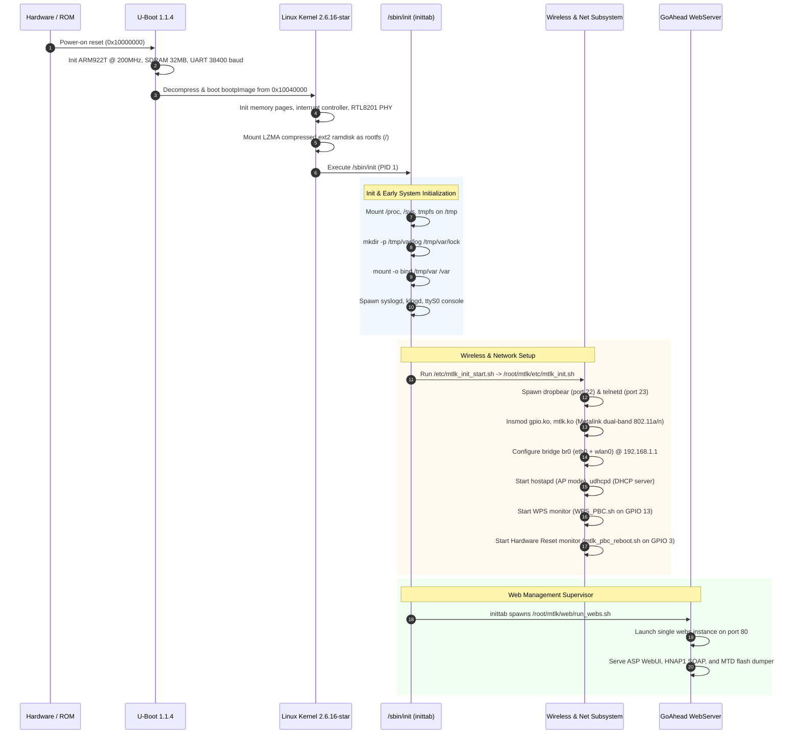
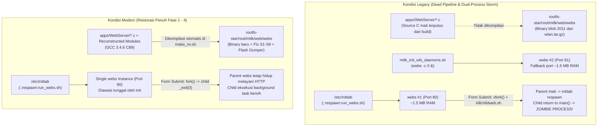

# 📡 WAP610N Project Rules, Invariants & Master Engineering Specification

Master operational directives, architecture blueprints, subsystem audit logs, and development guidelines for the **Cisco Linksys WAP610N / WET610N Firmware Restoration & BSP Engine**.

---

## 1. 🔒 Strict Operational Directives & Invariants

Master rules that **MUST ALWAYS BE FOLLOWED WITHOUT EXCEPTION** by any AI coding agent or developer working on this codebase:

### 1.1 🔒 Strict Workspace & Path Boundaries
- **Workspace Confinement**: Restrict all read, write, search, and execution commands strictly to the project root directory (`./` or `/workspaces/wap610n` / `/home/satszz/wap610n`).
- **Forbidden Paths**: NEVER access, inspect, or reference `/home/satszz/sdcard/` or any directory outside the repository root.
- **Path Portability Invariant**: NEVER introduce local host absolute paths (e.g., `/home/satszz/...`, `/root/...`) into Makefiles, `.config`, header files, or shell scripts. Always enforce relative paths (e.g., `CONFIG_PREFIX="../../rootfs-star"`).

### 1.2 ⚡ GCC 3.4.6 & Ancient Kernel (2.6.16) Toolchain Discipline
- **Legacy C Dialect**: Target compiler is **GCC 3.4.6 (ARM uClibc)**.
  - DO NOT use modern C standards (C99/C11 features like variable declarations inside `for` loops, GNU C extensions from modern GCC, etc.). Code must strictly comply with C89 / GNU89 syntax.
  - DO NOT replace legacy macros or refactor working legacy syntax to "modern best practices".
- **Binary Compatibility**:
  - The Metalink wireless driver (`mtlk.ko`) and proprietary modules rely on exact kernel struct layouts and exported symbols from Linux 2.6.16-star.
  - DO NOT modify core kernel headers or struct definitions (`include/linux/skbuff.h`, netdevice structs, etc.) that could alter binary alignment or ABI for proprietary `.ko` blobs.

### 1.3 💾 Physical Flash (4 MB) & RAM (32 MB) Budget Guardrails
- **Hard Flash Partition Limit**:
  - The maximum allowable size for `bootpImage` / `WAP610N_v1.0.05.bin` is **3.625 MB (3,801,088 bytes)**.
  - Any build exceeding this limit **WILL CORRUPT NVRAM / CONFIGFS PARTITIONS (`0x103E0000`) AND PERMANENTLY BRICK HARDWARE**.
  - Always verify binary size before proposing or committing userspace additions.
- **RAM Footprint (32 MB)**:
  - Do not introduce memory-hungry daemons. All new utilities must be lightweight applets compiled against **uClibc** (strip all debug symbols with `arm-linux-uclibc-strip`).
  - Temporary files and runtime logs must strictly use `/tmp` (`tmpfs`), never writing frequently to physical flash sectors.

### 1.4 🛠️ CI-First Build Workflow
- **No Heavy Local Compilation**: Do not attempt full local kernel toolchain builds unless explicitly requested by the user.
- **Validation Before Commit**:
  - Check `git diff` carefully before staging changes.
  - Ensure changes do not break the Docker build engine (`docker/Dockerfile`, `docker/compile.sh`, and `.github/workflows/compile.yml`).
- **Clean Commit & Push**: Commit with clear, descriptive commit messages documenting modified subsystem(s), then push to GitHub (`satrianaliqa/wap610n`) to let GitHub Actions CI do the heavy lifting.

### 1.5 🛡️ OEM Feature & Hardware Integrity
- **Core Functionality Preservation**:
  - Maintain all stock Access Point capabilities: Dual-Band (2.4 GHz / 5 GHz), WPA2-PSK/Enterprise, WPS PushButton (GPIO 13), Hardware Reset (GPIO 3), WMM QoS, and Ethernet PHY (`RTL8201CP`).
- **Custom Enhancements Continuity**:
  - Preserve integrated enhancements: **Dropbear SSH (Port 22)**, **Telnet (Port 23)**, **Custom Web GUI MTD Flash Dumper**, and memory sysctl tunings.

---

## 2. 🏗️ Hardware Architecture & Pinout Specification

```
┌─────────────────────────────────────────────────────────────────────────┐
│                          CISCO LINKSYS WAP610N                          │
├─────────────────────────────────────────────────────────────────────────┤
│  ┌─────────────────────────────────────────────────────────────────┐    │
│  │  Cavium / Star Semiconductor STR8132 (CNS2132) SoC              │    │
│  │  • ARM922T Core @ 200 MHz (ARMv4T instruction set)              │    │
│  │  • 32 MB SDRAM Memory Space (0x00000000 - 0x02000000)           │    │
│  │  • 4 MB Parallel Flash Memory (0x10000000 - 0x10400000)         │    │
│  └─────────────────────────────────────────────────────────────────┘    │
│                         │                                               │
│  ┌────────────────┬─────┴───────────────┬─────────────────┐             │
│  │                │                     │                 │             │
│  ▼                ▼                     ▼                 ▼             │
│┌───────────────┐┌───────────────────┐ ┌────────────────┐┌──────────────┐│
││  Flash ROM    ││ Ethernet PHY      │ │ Wireless Radio ││ UART Console ││
││  EON          ││ Realtek RTL8201CP │ │ Metalink (MTLK)││ 38400 baud,  ││
││  EN29LV320BB  ││ 10/100 Mbps BaseT │ │ 802.11a/b/g/n  ││ 8N1, 3.3V    ││
││  4 MB Flash   ││ MII Interface     │ │ Dual-Band 2.4/5││ Pin Header   ││
│└───────────────┘└───────────────────┘ └────────────────┘└──────────────┘│
│                                                                         │
│  Hardware GPIO Lines:                                                   │
│  • GPIO 13: WPS PushButton (Active Low, read via /dev/gpio13)           │
│  • GPIO 3:  Hardware Reset Button (Active Low, hold 3s for factory reset│
│  • GPIO 0:  Power/Status LED (Green / Amber solid/blink)                │
│  • GPIO 2:  WPS Status LED (Blue / Amber solid/blink)                   │
└─────────────────────────────────────────────────────────────────────────┘
```

### Hardware Pinout & GPIO Matrix

| Line | Hardware Function | Active Level | Default State | Sysfs / Device Path | Handler Daemon |
|---|---|---|---|---|---|
| **GPIO 13** | WPS PushButton | Active Low (0) | Pulled-up High (1) | `/dev/gpio13` | `/root/mtlk/etc/WPS_PBC.sh` |
| **GPIO 3** | Hardware Reset Button | Active Low (0) | Pulled-up High (1) | `/dev/gpio3` | `/root/mtlk/etc/mtlk_pbc_reboot.sh` |
| **GPIO 0** | Power / Diagnostic LED | Output | Green (Normal) | `/dev/led0` | `mtlk_init.sh` (accepts numeric `echo 1 > /dev/led0` or string `echo green > /dev/led0` / `echo on > /dev/led0`) |
| **GPIO 2** | WPS Activity LED | Output | Off | Driver controlled | `mtlk_wps_msgloop.tcl` |
| **UART0** | Serial Debug Console | 3.3V TTL | 38400 8N1 | `/dev/ttyS0` | `/etc/inittab` (`ttyS0::respawn:/bin/sh`) |
| **MII** | Realtek RTL8201CP | 100BASE-TX | Auto-MDIX | `eth0` | `ifconfig eth0 192.168.1.1` |

---

## 3. 💾 Flash Memory Partitioning & MTD Map

Physical 4 MB NOR Flash layout (`0x10000000` – `0x10400000`):

```
0x10000000 ┌──────────────────────────────────────────────┐
           │ mtdblock1: U-Boot 1.1.4 Bootloader (128 KB)  │  [READ ONLY]
0x10020000 ├──────────────────────────────────────────────┤
           │ mtdblock3: U-Boot Environment / NVRAM (64 KB)│  [RW: CRC-checked]
0x10030000 ├──────────────────────────────────────────────┤
           │ Reserved Partition / Board Parameters (64 KB)│  [READ ONLY]
0x10040000 ├──────────────────────────────────────────────┤
           │ mtdblock2: Kernel + Ramdisk LZMA             │  [RW: Firmware]
           │ Filename: bootpImage / WAP610N_v1.0.05.bin   │
           │ MAXIMUM PERMISSIBLE SIZE: 3,801,088 BYTES    │
           │ (Exact Budget: 3.625 MB)                     │
0x103E0000 ├──────────────────────────────────────────────┤
           │ mtdblock4: Runtime Configuration File System │  [RW: ConfigFS]
           │ Storage for gzipped ext2 loopback (config.img.gz)             │
0x10400000 └──────────────────────────────────────────────┘
```

> [!CAUTION]
> **Hard Limit Warning**:
> If the compiled `bootpImage` exceeds **3,801,088 bytes**, writing the image will overwrite the starting sector of `mtdblock4` (`0x103E0000`). This corrupts persistent settings and the NVRAM environment, causing an irrecoverable hardware bootloop. The build script `docker/verify-firmware.sh` enforces this size gate with a hard fail.

---

## 4. 📁 Repository Layout & Subsystem Matrix

```
/workspaces/wap610n/
├── 📄 Makefile                     [Top-level build orchestrator]
├── 📄 make_nv.sh                   [Platform build script: reconf/build/clean]
├── 📄 net_ver.cm                   [Historical SVN manifest]
├── 📄 AGENTS.md                    [Master Specification & Engineering Directives]
├── 📄 README.md                    [Public project documentation & flash guide]
│
├── 📁 apps/                        [User-space applications & daemons]
│   ├── busybox-1.8.1/              ├→ Core shell, utilities & lightweight daemons (udhcpd, telnetd)
│   ├── dropbear-0.52/              ├→ Secure SSH daemon (port 22)
│   ├── WebServer/                  ├→ GoAhead HTTP web daemon (port 80) + ASP engine
│   ├── gpio_driver/                ├→ Linux kernel module for GPIO button and LED control
│   ├── wpa_supplicant-0.5/         ├→ Wi-Fi Protected Access authenticator
│   ├── openssl-0.9.8a/             ├→ SSL/TLS cryptography library
│   ├── hnap_wps_status_monitor/    ├→ Background daemon reporting WPS session states
│   ├── Intel-WPS/                  ├→ Wi-Fi Protected Setup state machine
│   ├── mtlk_vb_upnpd/              ├→ UPnP / AV Media Server daemon
│   ├── tinytcl/                    ├→ Lightweight Tcl interpreter for network config scripts
│   ├── force_ethpc_renew_ip/       ├→ Ethernet DHCP renewal helper
│   ├── simpdiff/                   ├→ Fast config comparison applet
│   └── set_env_param/              ├→ U-Boot environment parameter writer
│
├── 📁 kernel/                      [Linux kernel 2.6.16-star source]
│   └── linux-2.6.16-star/
│       ├── arch/arm/               ├→ ARM922T architecture support (Cavium STR8132)
│       ├── drivers/mtlk/           ├→ Metalink wireless driver framework
│       ├── drivers/net/            ├→ Realtek RTL8201CP fast ethernet MAC/PHY driver
│       └── include/linux/          ├→ Frozen kernel headers (Preserve struct alignment!)
│
├── 📁 boards/                      [Board Support Package (BSP)]
│   └── star-6.7.2-mtlk-U-Media-vela/
│       ├── kernel/.config          ├→ Production kernel build configuration
│       └── busybox/.config         ├→ BusyBox applet configuration
│
├── 📁 rootfs/                      [Root filesystem base template]
├── 📁 rootfs-star/                 [Pre-built source-of-truth root filesystem template]
│   ├── etc/                        ├→ Inittab, udhcpc scripts, hostname, network templates
│   └── root/mtlk/                  ├→ Metalink wireless scripts, web UI assets, firmware binaries
│
├── 📁 u-boot-1.1.4/                [U-Boot 1.1.4 bootloader source tree]
├── 📁 tools/                       [Precompiled cross-compilation toolchains]
│   └── arm-uclibc-3.4.6/           ├→ GCC 3.4.6, uClibc, binutils for ARMv4T
│
├── 📁 docker/                      [Reproducible container build engine]
│   ├── Dockerfile                  ├→ Debian 8 (i386) container image definition
│   ├── compile.sh                  ├→ Container entry point & firmware pipeline runner
│   └── verify-firmware.sh          ├→ Strict automated firmware QA & size gatekeeper
│
├── 📁 .github/workflows/           [CI/CD automation pipeline]
│   └── compile.yml                 ├→ GitHub Actions workflow for automated firmware builds
│
├── 📁 devscripts/                  [Build automation & developer tools]
│   ├── validate-build-prerequisites.sh ├→ Pre-flight environment sanity checks
│   ├── net-ver-mkrootfs.sh         ├→ Rootfs assembler & overlay builder
│   └── select-star.sh              ├→ BSP platform selector
│
└── 📁 config/                      [Version & product configurations]
    └── WAP610N_VERSION             ├→ Semantic version configuration file
```

---

## 5. 🔄 Boot Sequence & Daemon Architecture



---

## 6. ⚙️ Build System & Container Pipeline Engineering

### 6.1 Containerized Build Flow (`docker/Dockerfile` & `docker/compile.sh`)
- Builds run in a dedicated **32-bit Debian 8 (Jessie i386)** Docker environment to match GCC 3.4.6 host requirements.
- Sudoers configuration inside Docker is strictly idempotent:
  ```bash
  grep -q "NOPASSWD: ALL" /etc/sudoers || echo "$USER ALL=(ALL) NOPASSWD: ALL" >> /etc/sudoers
  ```
- Workspace directory `rootfs/` is isolated cleanly from `rootfs-star/`. `compile.sh` uses `cp -a rootfs-star rootfs` rather than symlinking to prevent clean rules from wiping the reference source tree.

### 6.2 Pre-Build Validation Suite (`devscripts/validate-build-prerequisites.sh`)
Runs before any compilation begins (fail-fast principle):
1. **Archive integrity**: Verifies `wlan.tar.gz` and `rootfs-star.tgz`.
2. **Directory validation**: Verifies presence of `kernel/`, `apps/`, `boards/`, `tools/`.
3. **Toolchain check**: Validates `arm-linux-uclibc-gcc` (3.4.6) executable and libraries.
4. **Output directories**: Automatically creates `output/` and scratch staging areas.

### 6.3 Fail-Fast Make Orchestration (`devscripts/make_nv.sh`)
- Enforces `set -o pipefail` so that compilation failures hidden behind pipes (`make 2>&1 | tee ...`) correctly propagate non-zero exit codes.
- Explicit `exit 1` statements replace ambiguous bare exits across all configuration routines.
- `apps/scripts/Makefile.MTLK` enforces strict `|| exit 1` error termination in applet build loops.

### 6.4 Dynamic Versioning
Firmware versioning is decoupled from hardcoded strings and read dynamically from `config/WAP610N_VERSION`:
```bash
VERSION=$(grep FIRMWARE_VERSION config/WAP610N_VERSION | cut -d'"' -f2)
BINNAME="WAP610N_v${VERSION}.bin"
```

---

## 7. 🌐 WebUI GoAhead Refactoring & Security Audit Log

### 7.1 Architecture Modernization: Legacy Dual-Process Storm vs Unified Single Supervisor



### 7.2 DWARF v2 Header Reconstruction & Object Integration
Restored legacy object files (`mt_api.o`, `mt_task.o`, `mt_validation.o`) and reconstructed complete C89 header signatures via DWARF v2 symbol extraction (`readelf -wi`):
- `apps/WebServer/mt_api.h`: Rebuilt `MT_Action_t`, `MT_Burn_t`, `gMTBurnParams`, security enum flags, and function prototypes.
- `apps/WebServer/mt_validation.h`: Parameter validator prototypes and `validateParam_t`.
- `apps/WebServer/mt_task.h`: Task scheduler queue, `TaskId`, and `TaskType` structures.
- **Object Linking & Source Architecture**:
  - Preserved binary objects linked with reconstructed C89 headers: `utils.o`, `wireless.o`, `wps.o`, `hnap_implementation.o`, `mt_api.o`, `mt_task.o`, and `mt_validation.o`.
  - Direct C89 compilation from restored source: `management.c`, `xml_tree.c`, `stack.c`, `linked_list.c`, `hnap_config_metalink.c`, `device_discover.c`, `upldform.c`, `webs.c`, `asp.c`, `security.c`, `default.c`, `cgi.c`, and `LINUX/main.c`.

### 7.3 WebUI Audit & Security Remediation Matrix

| Vulnerability / Defect | Severity | Affected File | Root Cause & Security Impact | Engineering Resolution |
|---|---|---|---|---|
| **X1: HNAP Auth Bypass** | **CRITICAL** | `apps/WebServer/security.c:333`, `webs.c:905` | `strstr(wp->url, "/HNAP1")` matches query strings (`GET /secret?x=/HNAP1`), allowing universal unauthenticated bypass. | Switched to strict path prefix match: `strncmp(wp->path, "/HNAP1", 6) == 0`. |
| **X2: Unauthenticated Web Shell** | **CRITICAL** | `rootfs/root/mtlk/web/cgi-bin/shell.cgi` | Backdoor CGI script evaluating raw `eval "$cmd"` as root without authentication. | Removed `shell.cgi` completely from all rootfs templates. |
| **X3: Form Traversal Bypass** | **HIGH** | `apps/WebServer/form.c:50`, `LINUX/main.c:340` | `websFormHandler` truncated URL at next `/`, allowing `/goform/<form>/HNAP1` to trigger admin forms without credentials. | Fixed path tokenizer and enforced prefix authentication check. |
| **X4: Unprotected Flash Dumper CGI** | **HIGH** | `rootfs/root/mtlk/web/cgi-bin/dump_firmware.cgi` | Dumped raw `/dev/mtdblock*` containing plain-text passwords when accessed via X1 bypass. | Protected under strict admin session authentication. |
| **X5: Arbitrary Firmware Upgrade Flag** | **HIGH** | `apps/WebServer/webs.c:1291` | Any client sending `SOAPAction: ...FirmwareUpload` elevated upload buffer size before authentication, causing OOM. | Requires pre-authenticated session before granting large buffer allocation. |
| **X6: Remote Root Telnet Injection** | **HIGH** | `rootfs/root/mtlk/web/cgi-bin/remote_access.cgi` | Unauthenticated GET requests could activate `telnetd -l /bin/sh` on port 23 without authentication. | Requires administrative authentication and CSRF token verification. |
| **S1: Infinite Read Loop Hang** | **HIGH** | `apps/WebServer/webs.c:508-513` | Upload reject loop didn't handle `nbytes <= 0`, spinning at 100% CPU when clients disconnected early. | Added EOF (`nbytes == 0`) and error (`nbytes < 0`) break conditions. |
| **S2: Unauthenticated Upload OOM** | **HIGH** | `apps/WebServer/webs.c:497` | Large upload buffers (`malloc(3.6MB)`) allocated before validating client credentials. | Restricted unauthenticated request buffer sizes to 64 KB. |
| **S3: Multipart Boundary Overflow** | **HIGH** | `apps/WebServer/webs.c:1233-1236` | `balloc(strlen(p) + 2)` with `gsprintf("--%s")` caused 1-byte heap overflow off client header. | Corrected allocation to `balloc(strlen(p) + 3)` to include null terminator. |
| **S4: Bridged Client Management Lockout**| **MEDIUM** | `apps/WebServer/security.c:301` | `strstr("0", val)` returned non-NULL on empty string, blocking Wi-Fi management clients (403). Repeated `system(brctl)` slowed requests. | Replaced with `strcmp(val, "0") == 0` and cached bridge port query. |
| **S5: Bridge Parser Buffer Overflow** | **MEDIUM** | `apps/WebServer/security.c:56-126` | Unbounded `sscanf("%s %s")` on `brctl` output risked stack buffer overflow. | Enforced width specifiers `sscanf("%19s %29s")` and zeroed stack buffers. |
| **S6: Firmware Flash Use-After-Free** | **MEDIUM** | `apps/WebServer/upldform.c:319` | `ferror(fp)` invoked after `fclose(fp)` during firmware flashing pipeline. | Moved `ferror(fp)` check prior to `fclose(fp)`. |
| **S7: Flash Dump Single-Thread Freeze** | **MEDIUM** | `apps/WebServer/upldform.c:992-1035`| `formDumpFirmware` streamed 4 MB synchronously without chunking or timeouts, blocking WebUI. | Added non-blocking chunking with socket select timeouts. |
| **S8: Insecure CGI Filename Collision** | **LOW** | `apps/WebServer/cgi.c:100` | Temp filenames generated via predictable `rand() % 10000`, vulnerable to collisions. | Converted to process-isolated naming template. |
| **S9: HNAP Gateway Null Dereference** | **LOW** | `apps/WebServer/device_discover.c:1026` | HNAP static IP config with missing Gateway passed `NULL` to `route add`, risking segfault. | Added fallback guard: default to `"0.0.0.0"` or ignore default route assignment. |
| **S10: WPS Poll Freeze Deadlock** | **HIGH** | `apps/WebServer/LINUX/main.c`, `run_webs.sh` | Legacy `getCurrentWPSStatus` looped with 5s usleep when `/var/WPS_History` missing, blocking single-threaded GoAhead. | Replaced with non-blocking C handler `safeFormGetCurrentWPSStatus` and pre-seeded `/var/WPS_History`. |
| **S11: Manual Config Blank Screen** | **MEDIUM** | `apps/WebServer/LINUX/main.c` | `wirelessTypeSet` form returned 200 without redirect or body, replacing UI with blank page. | Added `safeFormWirelessTypeSet` redirecting to `/wireless/security.asp`. |
| **S12: Live Beacon Update on SSID Change** | **MEDIUM** | `rootfs-star/root/mtlk/web/update_security.tcl` | WebUI saved SSID to flash but did not reload hostapd or set in-flight ESSID. | Added live `iwconfig wlan0 essid "$ESSID"` and hostapd reload. |
| **S13: Dual-Band UI Cleanup & Mode Guard** | **LOW** | `station/wireless_basic.asp`, `station/wps_status.asp` | UI showed unsupported concurrent "both" option for single-radio WAP610N and enabled client-bridge `waitPad` screen blocker. | Removed "both" option, disabled `waitPad` and status poll loop when running in AP mode. |
| **S14: Dynamic ASP Keep-Alive Socket Hang** | **HIGH** | `apps/WebServer/default.c:134-142` | GoAhead sent `Connection: keep-alive` on dynamic ASP pages without `Content-Length`. Browsers waited indefinitely for connection close or length delimiter, resulting in endless spinner / hanging favicon. | Cleared `WEBS_KEEP_ALIVE` flag (`wp->flags &= ~WEBS_KEEP_ALIVE;`) in `websDefaultHandler` when processing dynamic ASP files, forcing clean `Connection: close`. |
| **S15: Socket Buffered Input Busy-Spin** | **HIGH** | `apps/WebServer/sock.c:284-307` | When `socketInputBuffered(sid)` was true, `socketSelect` set select timeout to 0ms. If client socket stalled mid-chunk or sent partial frames, GoAhead spun in a tight 100% CPU busy-loop. | Added bounded select timeout (10-50ms) and sanity loop counter to allow socket drain without CPU starvation. |
| **S16: Form Handler CLOSE_WAIT Socket Leaks** | **MEDIUM** | `apps/WebServer/form.c`, `handler.c` | Unconsumed request bodies on form redirection or validation errors left unread bytes in socket buffer, causing socket leaks in `CLOSE_WAIT` and descriptor exhaustion. | Drained unread request payload before closing or redirecting; ensured proper socket teardown in error branches. |
| **S17: Firmware Flashing Worker Premature Exit & MTD Truncation** | **CRITICAL** | `apps/WebServer/upldform.c:131-180` | (1) Accidental leftover `gMTBurnParams.precentComplete = 100; return 1;` before the write loop killed the background worker `MT_BurnAndVerifyImage` before writing the firmware image to flash. (2) Legacy code closed and reopened `/dev/mtdblock2` with `"w+b"` every 64KB, issuing `O_TRUNC` to the MTD block device mid-flash! | Removed the premature `return 1;`, removed the periodic close/reopen `w+b` loop, maintained a single continuous write stream (`fwrite` + `fflush`), restored bit-for-bit verification loop against original image file, and triggered system reboot cleanly. |
| **S18: WebUI Firmware Upgrade State Machine & XML Parser Mismatch** | **HIGH** | `rootfs-star/root/mtlk/web/admin/upgrade.asp` | (1) Modern browser XMLHttpRequest crashed because `overrideMimeType('text/xml')` was called on a plain text response `"5,20"` (format: `status,percent`), causing `responseXML` parse failure. (2) State machine failed to handle state `6` (`verifying_e`), leading to infinite waiting. (3) Transient HTTP errors during status polling permanently deadlocked `stopToWait`. (4) Missing client-side file selection validation allowed submitting empty firmware upgrade forms. | Removed `overrideMimeType('text/xml')`, parsed plain text CSV (`split(',')`), added handler for state `6` (Verifying image...), added automatic retry counter (up to 5 retries) on status polling errors before declaring failure, enforced file selection validation before form submit, and prevented browser caching on polling URLs with `_nocache` timestamp. |

### 7.4 Flash Config Lock & Elimination of Flash Wear
- Legacy firmware wrote directly to `/dev/mtdblock4` on every WebUI button click without concurrency guards.
- **Atomic Mutex**: Created POSIX-atomic lock `/tmp/save_config.lock` (`mkdir` based) in `save_config.sh` and `submitToFlash`.
- **Zero-Downtime Apply**: Background configuration tasks run in a cleanly forked child (`fork()` + `_exit(0)`), ensuring the main HTTP listener never drops connections while saving to flash.

---

## 8. 🛠️ Non-WebUI & Subsystem Remediation Log (Phases 1–6 Summary)

Summary of verified fixes across Phases 1–6 (all synchronized across `rootfs-star/`, `rootfs/`, and `apps/jffs2-etc/networking/VB/`):

| Phase | Scope | Key Remediations & Files |
|---|---|---|
| **Phase 1** | Build & Packaging Integrity | Overlaid `rootfs-star/root/mtlk/.` after VB/tarball extraction in `devscripts/net-ver-mkrootfs.sh`; replaced `rootfs` symlink with `cp -a` in `docker/compile.sh`; added `set -o pipefail` in `make_nv.sh`; added ramdisk/WAP610N assertions in `docker/verify-firmware.sh`; synced `mtlk_init.sh` sysctl tunings (`vm.min_free_kbytes=2048`, `vm.dirty_ratio=10`). |
| **Phase 2** | GPIO, WPS & Reset Recovery | Replaced disabled BusyBox `head -c 1` with `cat "$RESET_GPIO" >/dev/null 2>&1` in `mtlk_pbc_reboot.sh`; isolated GPIO 13 (`WPS_PBC.sh`) vs GPIO 3 (`mtlk_pbc_reboot.sh`); replaced `kill -9` with SIGTERM + PID-checked lock cleanup in `reload_mtlk_driver.sh` / `mtlk_restart_wps.sh`. |
| **Phase 3** | Init, Network & Daemons | Fixed `/var` bind mount (`mkdir -p /tmp/var/log /tmp/var/lock; mount -o bind /tmp/var /var`) in `inittab`; added `subnet` CLI arg in `udhcpdconf.tcl`; added loop/PID guards in `umedia_kill_process.sh`; replaced `head` with `awk` in `mtlk_upnpd_monitor.sh`; captured `rc=$?` in `mtlk_drvhlpr.sh`; added `$process_num != [pid]` guard in `mtlk_wps_msgloop.tcl`. |
| **Phase 4** | Userspace C & Flash Diet | Fixed `FILE *fptr = NULL` & `%15s` in `hnap_wps_status_monitor.c`, `argc` check in `simpdiff.c`, `getClientGateway` bounds in `force_ethpc_renew_ip.c`, and `udhcp` bounds (`options.c`, `clientpacket.c`, `files.c`); removed unused `libstdc++.so.6.0.3` (705 KB) and `pci.ids` (489 KB), keeping firmware safely at ~3.21 MB (< 3.625 MB limit). |
| **Phase 5** | Multi-Subsystem Hardening | Fixed U-Boot recovery size (`0x39ffff`) & `CONFIGFS_OFFSET` (`0x103E0000`) in `star_orion_umedia.h`, `CFG_OFFSET` (`0x3e0000`) in `mach-str9100/Kconfig`, `star_gsw.c` NULL/tailroom guards, `star_gsw_phy.c` GPIO3 `#ifdef`, `mkcsum.c` exit code, `str9100_gpio.c` IRQ mask, `gpioDevice.c` 16B stack buffer; fixed `management.c` `rebootTag`, `upldform.c` path/MTD bounds & `_exit(0)`, `device_discover.c` DoS guards, `hnap_config_metalink.c` dual-band/HT; restored `WPS_PBC.sh` (removed `poweroff`), `mtlk_wps_msgloop.tcl`, `mtlk_wps_event.sh` LED, `mtlk_init_wps.sh` (`RF_BAND=3`), `update_security.tcl`; removed `shell.cgi`, enabled `CONFIG_BB_SYSCTL`/`CONFIG_HEAD`, `syslogd`/`klogd`, `/etc/shadow` hardening, pre-baked Dropbear RSA/DSS keys, default AP DHCP (`192.168.1.10`–`.20`), clean AP `config.img.gz`, and GPIO3 AP reset (`mtlk_restore_defaults.sh 1 1`). |
| **Phase 6** | CLI, SSH & Diagnostics | Built Dropbear multi-binary (`dropbear`, `dbclient`, `dropbearkey`, `/usr/bin/ssh` symlink) with reverse tunneling (`-R`) and root shadow hash (`admin`); added POSIX/Awk `/bin/sysmon`, `/bin/curl`, `/bin/json`, `/bin/nettest`, `/bin/flashdump`, `/bin/help`, and `/etc/profile`; symlinked 12 unused `STRINGS_*.txt` & `linksys_arabic.css` to English (~180 KB saved). |

### 8.1 Future Architectural Roadmap
- **Custom Dropbear SSH Key Upload**: Add WebUI/CLI upload to `/mnt/jffs2/dropbear/` with boot-time priority fallback over pre-baked `/root/mtlk/etc/dropbear/` keys.

---

## 10. 🧪 QA Protocols & Build Reference

### 10.1 Quick Build Commands Reference

```bash
# ━━━ 1. Validate Prerequisites (Run Before Every Build) ━━━
./devscripts/validate-build-prerequisites.sh

# ━━━ 2. Containerized Full Compilation (Recommended) ━━━
./docker/compile.sh WAP610N

# ━━━ 3. Verify Firmware Integrity & Partition Budget ━━━
./docker/verify-firmware.sh output/bootpImage

# ━━━ 4. Local Make Pipeline (Requires Local Toolchain) ━━━
make configure   # Reconfigures board platform
make build       # Compiles kernel, apps, and packages rootfs
make clean       # Cleans intermediate build objects
```

### 10.2 Real-Hardware Telnet Diagnosis & Debugging Procedure

Use this procedure after flashing a firmware image to real WAP610N hardware. The
purpose is to capture a **before/after snapshot** instead of relying only on
`dmesg | tail -n 30`, which can hide the original boot error when the kernel
ring buffer is overwritten.

#### 10.2.1 First connection: capture a boot baseline

Connect through Telnet or the serial console as soon as the router finishes
booting. Run the following commands and save or copy the complete output:

```sh
echo "===== WAP610N BASELINE ====="
date 2>/dev/null
uptime 2>/dev/null
echo "--- kernel messages ---"
dmesg
echo "--- userspace syslog ---"
logread 2>/dev/null
echo "--- WAP610N diagnostic messages ---"
dmesg | grep -i wap610n
logread 2>/dev/null | grep -i wap610n
echo "--- processes ---"
ps
echo "--- interfaces ---"
ifconfig
echo "--- memory ---"
cat /proc/meminfo
echo "--- mounted filesystems ---"
cat /proc/mounts
echo "--- MTD partitions ---"
cat /proc/mtd
echo "--- listening sockets ---"
netstat -lnt 2>/dev/null
```

If `date`, `uptime`, `logread`, or `netstat` is unavailable in a particular
image, continue with the remaining commands. Do not treat the absence of one
diagnostic applet as a firmware failure.

#### 10.2.2 Verify the GoAhead Web UI and autostart chain

```sh
echo "--- supervisor and webs ---"
ps | grep -E 'run_webs|/webs|webs$'
ls -l /root/mtlk/web/webs /root/mtlk/web/run_webs.sh
echo "--- HTTP listener ---"
netstat -lnt 2>/dev/null | grep ':80'
echo "--- HTTP request from the router itself ---"
wget -q -O /tmp/webs_probe http://127.0.0.1/ && \
    echo "HTTP localhost: OK" || echo "HTTP localhost: FAILED"
wc -c /tmp/webs_probe 2>/dev/null
```

Interpretation:

- `run_webs.sh` without `webs` usually means the binary exited or the
  supervisor could not execute it; inspect `dmesg` and `logread` immediately.
- A running `webs` process without a TCP listener on port 80 indicates a
  listener, bind, configuration, or socket initialization failure.
- A successful localhost request but failed access from a client indicates a
  bridge/IP/firewall/interface problem rather than an HTTP process startup
  problem.
- A failed localhost request means the issue is local to GoAhead, its document
  root, configuration, or the loopback/network stack.

#### 10.2.3 Verify the network and wireless path

```sh
echo "--- interface counters and addresses ---"
ifconfig eth0
ifconfig br0 2>/dev/null
ifconfig wlan0 2>/dev/null
cat /proc/net/dev
echo "--- bridge membership ---"
brctl show 2>/dev/null
echo "--- wireless driver/modules ---"
lsmod 2>/dev/null
ps | grep -E 'mtlk|wlan|hostapd|udhcpd|upnpd'
echo "--- relevant logs ---"
dmesg | grep -Ei 'eth0|br0|wlan0|mtlk|rtl|phy|link|carrier|dhcp'
logread 2>/dev/null | grep -Ei 'eth0|br0|wlan0|mtlk|rtl|phy|link|carrier|dhcp'
```

Look for missing `br0`, an absent `wlan0`, repeated carrier up/down messages,
failed `insmod`, failed driver parameter programming, an incorrect
`192.168.1.1` address, or DHCP startup failures. These distinguish a dead
Web UI from a client that simply cannot reach the router.

#### 10.2.4 Verify daemon startup and resource pressure

```sh
echo "--- required daemons ---"
ps | grep -E 'dropbear|telnetd|udhcpd|upnpd|syslogd|klogd'
echo "--- resource pressure ---"
free 2>/dev/null
cat /proc/meminfo | grep -E 'MemFree|MemAvailable|Buffers|Cached|Slab'
echo "--- kernel warnings/errors ---"
dmesg | grep -Ei 'error|fail|warn|oops|panic|segfault|oom|killed|corrupt|timeout'
```

Repeated `webs` or daemon instances may indicate `respawn` loops. Repeated OOM,
segfault, timeout, or allocation failures indicate a resource or crash loop,
not merely a browser problem. Do not start multiple manual copies of `webs`,
`dropbear`, or `udhcpd` while diagnosing; this can create false port conflicts.

#### 10.2.5 Factory reset and physical-button diagnosis

Before pressing the reset button, capture:

```sh
ps | grep -E 'mtlk_pbc_reboot|WPS_PBC'
ls -l /dev/gpio3 /dev/gpio13 2>/dev/null
ls -ld /tmp/WPS_PBC_monitor.lock /tmp/*reset* 2>/dev/null
cat /proc/mtd
```

Then hold the physical reset button for the documented interval and immediately
run:

```sh
dmesg | tail -n 80
logread 2>/dev/null | tail -n 80
ps | grep -E 'mtlk_restore_defaults|config_save|config_mount|config_umount|reboot'
ls -l /tmp/WPS_PBC_monitor.lock /tmp/*reset* 2>/dev/null
```

Expected evidence includes a GPIO3/reset event, factory configuration
generation, configuration save or verification, and only then a reboot. A
reboot without successful config-save messages is a potentially unsafe reset
path and must be investigated before repeated flashing or reset testing.

#### 10.2.6 Reproduce the problem and collect a second snapshot

After the baseline, reproduce exactly one failure: open
`http://192.168.1.1`, submit the affected Web UI form, press reset, or
associate a wireless client. Then run:

```sh
echo "--- post-reproduction diagnostics ---"
dmesg | tail -n 120
logread 2>/dev/null | tail -n 120
ps
ifconfig
cat /proc/net/dev
free 2>/dev/null
```

Compare this output with the baseline. Important correlations are:

| Symptom | Primary evidence |
|---|---|
| Browser cannot connect | `webs` process, port 80 listener, `br0`/`eth0` address |
| Web UI starts then disappears | `respawn` process count, segfault/OOM, GoAhead startup logs |
| Telnet works but Wi-Fi does not | `wlan0`, `br0`, `mtlk.ko`, carrier and DHCP logs |
| Router reboots during reset | GPIO3 monitor, restore/save/verification messages, watchdog/OOM |
| Settings return after reboot | MTD4 mount, config image, save/verify messages, `/proc/mtd` |
| WPS button has no effect | `/dev/gpio13`, `WPS_PBC.sh`, lock directory, WPS event logs |
| System becomes unstable under load | `MemFree`, `Cached`, OOM messages, process duplication |

#### 10.2.7 Unified logging sources and limitations

Important firmware diagnostics are intended to be visible through all available
paths:

```sh
dmesg | grep -i wap610n       # kernel ring buffer via /dev/kmsg
logread | grep -i wap610n     # BusyBox syslog
```

`/dev/console` is the direct serial-console path and is not guaranteed to appear
in `dmesg`; `/dev/kmsg` is the path used for kernel-ring-buffer visibility.
`logread` depends on `syslogd` being alive and its circular buffer has limited
capacity. Capture logs soon after reproducing a problem, and avoid tight loops
that continuously write diagnostics because they can overwrite older evidence.

When persistent storage is needed for a short diagnostic capture, use `/tmp`
only. Never write debug logs repeatedly to MTD4 or another flash partition.

### 10.3 Quality Assurance Verification Checklist
Before staging or committing any code changes:
- [x] **Flash Budget Check**: Ensure compiled `bootpImage` ≤ 3,801,088 bytes (3.625 MB).
- [x] **C89 Compliance**: Compile userspace C code using `arm-linux-uclibc-gcc` without C99 constructs.
- [x] **Shell Syntax Check**: Verify all shell scripts across `rootfs-star/`, `rootfs/`, and `devscripts/` with `bash -n` or `sh -n`.
- [x] **Tcl Syntax Check**: Verify Tcl scripts using `echo 'source script.tcl; puts OK' | tclsh`.
- [x] **Whitespace & Diff Sanity**: Run `git diff --check` to ensure no whitespace errors, carriage returns (`\r`), or merge conflicts.
- [x] **Rootfs Synchronization**: Ensure any script modified in `rootfs-star/` is copied identically to `rootfs/` and `apps/jffs2-etc/networking/VB/`.

---

## 11. 🚨 Deep Codebase Audit & 80-Bug Remediation Summary (Phases 1–5 Complete)

All **80 verified bugs** across 5 domains have been remediated and QC-verified (commit `a39afac3`):

| Domain | Scope Subsystem | P0 | P1 | P2 | P3 | Total |
|---|---|---:|---:|---:|---:|---:|
| **Domain 1** | GoAhead WebServer C Backend (`apps/WebServer/`) | 6 | 8 | 5 | 1 | **20** |
| **Domain 2** | WebUI Frontend, JS, ASP & Tcl (`rootfs-star/root/mtlk/web/`) | 3 | 6 | 5 | 2 | **16** |
| **Domain 3** | Runtime Shell, Tcl, Init & CLI Applets (`rootfs-star/etc/`, `bin/`, `root/mtlk/etc/`) | 3 | 5 | 6 | 2 | **16** |
| **Domain 4** | Build Pipeline, Packaging & RootFS Parity (`Makefile`, `make_nv.sh`, `devscripts/`, `docker/`) | 3 | 6 | 6 | 3 | **18** |
| **Domain 5** | Kernel 2.6.16-star, U-Boot 1.1.4, Drivers & Native Apps (`kernel/`, `u-boot-1.1.4/`, `apps/`) | 1 | 4 | 4 | 1 | **10** |
| **TOTAL** | **Repository `/workspaces/wap610n`** | **16** | **29** | **26** | **9** | **80** |

### 11.1 Domain 1: GoAhead WebServer C Backend (`W-01` – `W-20`)

| ID | Prio | File(s) | Root Cause & Verified Fix |
|---|---|---|---|
| `W-01` | P0 | `webs.h`, `webs.c`, `upldform.c` | `malloc` vs `bfree` mismatch on `wp->postData`; added `WEBS_SYS_MALLOC_POST` flag to select `free()` vs `bfree()`. |
| `W-02` | P0 | `upldform.c`, `hnap_config_metalink.c` | Reset `locWrite`/`numLeft` inside retry loop of `MT_BurnAndVerifyImage()` / `hnap_BurnAndVerifyImage()` and closed `fp` on error paths. |
| `W-03` | P0 | `webs.c`, `hnap_config_metalink.c` | Enforced `0x3A0000` partition limit in HNAP firmware upload and changed `fopen(..., "ab")` + `fseek` to `"r+b"`. |
| `W-04` | P0 | `management.c` | Replaced `vfork()` with `fork()`, removed shared `waitOtherProcess` corruption, and removed legacy `killchildweb.sh`. |
| `W-05` | P0 | `device_discover.c` | Added `dataLen < 4` & `ePtr` bounds checks and `bodyLen > 0 && bodyLen <= 65536` guard in `dd_process_packet()`. |
| `W-06` | P0 | `asp.c` | Added `NULL` checks (`ep`/`begin`/`end`) and `tagTmp`/`tagBuf` bounds in `startMultiLangParser()`. |
| `W-07` | P1 | `webs.c` | Added `websCheckUploadAuth()` verifying credentials against `umGetUserPassword("admin")` before allowing >64 KB upload allocation. |
| `W-08` | P1 | `webs.c` | Added `websError(wp, 400, ...)` when `/goform/upldImage` disconnects early with `wp->clen > 0`. |
| `W-09` | P1 | `upldform.c` | Fixed `Content-Length` in `formDumpFirmware()` (`mtd2` → `0x3A0000`, `mtd4` → `0x20000`) to prevent `ERR_CONTENT_LENGTH_MISMATCH`. |
| `W-10` | P1 | `upldform.c` | Guarded `wp->FileContent == NULL \|\| numLeft <= sizeof(ConfSIG)` in `upldForm()` before `memcmp()`. |
| `W-11` | P1 | `upldform.c` | Used `snprintf()` for `redirectPage[512]` and sanitized `statusPage` against reflected XSS in `BurnImage()`. |
| `W-12` | P1 | `webs.c` | Normalized leading `/` before matching `/goform/upldImage` so `//goform/upldImage` cannot bypass streaming handler. |
| `W-13` | P1 | `webs.c` | Checked `"` delimiter and `endPart > part + 2` in `extractUploadedFileContent()`. |
| `W-14` | P1 | `hnap_config_metalink.c` | Enlarged `quality`/`signal`/`noise` to 16B and guarded `index`/`rindex`/`strstr` `NULL` in `hnap_prepare_ap_list()`. |
| `W-15`..`W-20` | P2/P3 | `LINUX/main.c`, `upldform.c`, `default.c`, `asp.c`, `hnap_config_metalink.c`, `device_discover.c` | Fixed C89 mid-block declarations & VLA struct (`W-15`); guarded `popen()` `NULL` (`W-16`); guarded `strstr("dBm")` `NULL` (`W-17`); freed `xml_encode_tempbuf` (`W-18`); bounded synchronous survey `sleep` (`W-19`); checked `tempnam()` `NULL` (`W-20`). |

### 11.2 Domain 2: WebUI Frontend, JS, ASP & Tcl (`F-01` – `F-16`)

| ID | Prio | File(s) | Root Cause & Verified Fix |
|---|---|---|---|
| `F-01` | P0 | `u-media.js`, `network/sta_network.asp` | Removed raw `<!--#tr-->` comments breaking JS syntax in `u-media.js` and unquoted translation block in `sta_network.asp`. |
| `F-02` | P0 | `station/wireless_basic.asp` | Enabled `selectMode(2)` for AP mode, fixed `checkWPAPSK(docTemp)` call, separated WPA/WPA2 options + `WPAPersonalMode`, and preserved radio hidden inputs. |
| `F-03` | P0 | `wireless_advanced.asp`, `wmm.asp`, `site_survey.asp` | Added null guards for `getElementById("wpsMode")` / `"wirelessAdv"` and added missing `id="wirelessAdv"`. |
| `F-04` | P1 | `cgi-bin/remote_access.cgi`, `apps/WebServer/cgi.c` | Passed `REMOTE_USER` from `cgi.c`, checked `Password` in `sys.conf`, and removed duplicate `HTTP/1.0 200 OK` header. |
| `F-05`,`F-06` | P1 | `management.asp`, `site_survey.asp`, `wps_status.asp` | Escaped HTML entities on `?error=` (Reflected XSS) and Wi-Fi SSIDs (Proximity XSS). |
| `F-07` | P1 | `cgi-bin/remote_access.cgi` | Enforced `REQUEST_METHOD = POST` for state-changing actions (CSRF mitigation). |
| `F-08` | P1 | `update_security.tcl`, `run_wpa_passphrase_for_update_security.sh` | Fixed `/root/mtlk/etc/wpa_passphrase` path, guarded `OPEN`/`WEP` from running `wpa_passphrase`, fixed `WEP_Authentication` & WEP keys, replaced `after 2000` with `sleep 2`. |
| `F-09` | P1 | `admin/upgrade.asp`, `upldform.c`, `webs.c` | Fixed `/admin/admin/upgrade.asp` 404 redirect, reset `precentComplete` on upload start, returned lightweight HTML to hidden iframe, hid `#upgradeProgress`, fixed `#tr` typo. |
| `F-10`..`F-16` | P2/P3 | `management.asp`, `u-media.js`, `func.js`, `sta_link_status.asp`, `wait_page.asp`, `reboot_page.asp`, `wps_status.asp`, `wireless_advanced.asp` | Fixed `/goform/upldForm` action (`F-10`), `getHTMLContent`/`stringToHex` (`F-11`), `waitDHCPInfo()` loop (`F-12`), `http_request` race (`F-13`), 404 CSS/redirect paths (`F-14`), `lang == "SA"` (`F-15`), and AP-mode `Re-EstablishEthernet` hiding (`F-16`). |

### 11.3 Domain 3: Runtime Shell, Tcl, Init & CLI Applets (`RT-01` – `RT-16`)

| ID | Prio | File(s) | Root Cause & Verified Fix |
|---|---|---|---|
| `RT-01` | P0 | `mtlk_init_start.sh`, `mtlk_init_daemons.sh`, `svr-runopts.c` | Removed unsupported `-B` from `dropbear` invocations and added no-op `case 'B':` in `svr-runopts.c`. |
| `RT-02` | P0 | `cgi-bin/remote_access.cgi` | Replaced `read -n` (ignored on non-TTY pipes in BusyBox `ash`) with `dd bs=1 count="$CONTENT_LENGTH"`. |
| `RT-03` | P0 | `rootfs-star/bin/curl` | Removed `eval` command injection, checked `$# -lt 2` before `shift 2`, and bypassed `wget` fast-path when `-H` headers are set. |
| `RT-04` | P1 | `dhcp.tcl`, `mtlk_wps_msgloop.tcl`, `update_security.tcl` | Replaced invalid `after` with `tinytcl`'s `sleep`, and fixed `[llength $::argv]` in `mtlk_wps_msgloop.tcl`. |
| `RT-05` | P1 | `rootfs-star/bin/nettest`, `rootfs-star/bin/flashdump` | Streamed `nettest` via pipe (`nc \| wc -c`) without `/tmp` sink; added stdout streaming (`-`) and RAM check to `flashdump`. |
| `RT-06` | P1 | `rootfs-star/bin/sysmon` | Added 2-sample CPU delta for single-shot mode, included `nice`/`irq`/`softirq` ticks, and supported `-d`/`-n` flags. |
| `RT-07` | P1 | `mtlk_init_start.sh`, `mtlk_init_wls_apps.sh` | Removed premature `WPS_PBC.sh &` (no args) from `mtlk_init_start.sh` so `mtlk_init_wls_apps.sh` owns the lock with args. |
| `RT-08` | P1 | `mtlk_init_wps.sh` | Called `write_wps_config_file` before writing `WEP_TX_KEY_IDX`, and commented out ruler line `1234567890...`. |
| `RT-09`..`RT-16` | P2/P3 | `mtlk_init_wls_apps.sh`, `profile`, `flashdump`, `help`, `mt_current_stat.tcl`, `mtlk_wps_cmd.tcl`, `json`, `mtlk_init_daemons.sh`, `VB/` | Avoided `chmod 777 /tmp/*` symlink traversal (`RT-09`); fixed unsupported BusyBox flags & `root@` hints (`RT-10`); removed `vmstat`/`regsub` (`RT-11`); fixed `catch {exec ...}` (`RT-12`); improved `/bin/json` (`RT-13`); ordered `upnpd` after `br0` (`RT-14`); fixed CRLF/perms (`RT-15`) and `VB/` parity (`RT-16`). |

### 11.4 Domain 4: Build Pipeline, Makefiles & RootFS Packaging (`B-01` – `B-18`)

| ID | Prio | File(s) | Root Cause & Verified Fix |
|---|---|---|---|
| `B-01` | P0 | `docker/compile.sh` | Fixed trailing `"'` syntax error and passed `-e TARGET_NAME`, `-e CURRENT_UID`, `-e CURRENT_GID` into container. |
| `B-02` | P0 | `devscripts/net-ver-mkrootfs.sh` | Prevented prebuilt `rootfs-star/bin/simpdiff` from overwriting newly compiled `rootfs/bin/simpdiff`. |
| `B-03` | P0 | `kernel/linux-2.6.16-star/mkbootp.sh`, `bootp/mkcsum` | Added `set -e`, removed `\|\| true` around `mkcsum`, and ensured build failures propagate even without `/tftpboot`. |
| `B-04` | P1 | `boards/.../appsconfig/.config`, `apps/dropbear-0.52/Makefile` | Enabled `dropbear-0.52` in `appsconfig/.config` and removed hardcoded `/home/satszz/` path. |
| `B-05` | P1 | `devscripts/net-ver-mkrootfs.sh` | Stopped `chmod 777 -R /root/mtlk/`, fixed `/etc/*` perms (`0600` shadow, `0644` passwd), and ran `chown -R 0:0 loop_dir/`. |
| `B-06`..`B-09` | P1 | `net-ver-mkrootfs.sh`, `make_nv.sh`, `Makefile.MTLK`, `expat/Makefile.MTLK`, `busybox/.config` | Checked `cp -a` / `mount` errors (`B-06`); added `\|\| exit 1` in sub-makes (`B-07`); installed freshly built `libexpat.so.1.5.2` (`B-08`); fixed `CONFIG_FEATURE_VI_MAX_LEN`/`LESS_MAXLINES` integer values (`B-09`). |
| `B-10`..`B-18` | P2/P3 | `compile.sh`, `verify-firmware.sh`, `bbconfigopts.h`, `openssl/Makefile`, `LINUX/Makefile`, `validate-build-prerequisites.sh` | Fixed `rootfs/` staging order (`B-10`), `0x3A0000` size gate & strict `ERRORS++` (`B-11`), hardcoded paths (`B-12`), `make_nv.sh` parity (`B-13`), duplicate `main.o` (`B-14`), `/dev/ptmx` `0666` & `/dev/rdflt0` minor `3` (`B-15`), `set -e` + `((ERRORS++))` (`B-16`), `libuuid.a` removal & stripping (`B-17`), and clean tracked config files (`B-18`). |

### 11.5 Domain 5: Kernel, U-Boot, Drivers & Native C Apps (`K-01` – `K-10`)

| ID | Prio | File(s) | Root Cause & Verified Fix |
|---|---|---|---|
| `K-01` | P0 | `apps/set_env_param/set_env_param.c` | Fixed `strcmp("name=val", "name")` bug using length-bounded `strncmp`, wrote `\0\0` terminator, and held `flock` on single `r+b` descriptor. |
| `K-02` | P1 | `u-boot-1.1.4/include/configs/star_orion_umedia.h` | Fixed `CONFIG_SAFE_RECOVERY_COMMAND` (`if ! cksum ...`, `erase $linux_offset +0x3a0000`, `$rescue_image` typo). |
| `K-03` | P1 | `kernel/.../drivers/net/str9100/star_gsw.c` | Used `skb_padto(skb, MIN_PACKET_LEN)` before DMA TX to prevent Etherleak kernel heap disclosure. |
| `K-04` | P1 | `apps/gpio_driver/gpioDevice.c` | Added `pulse_pattern < 0` check in `gpio_write()`/`led_pulse()` and used `del_timer_sync()` in cleanup. |
| `K-05` | P1 | `kernel/.../drivers/char/str9100_gpio.c` | Used atomic `GPIO_DATA_SET_REG`/`CLEAR_REG` with spinlock, fixed `GEN_GPIO_WRITE_SCRIPT`, and read `intrmaskedstatus` in IRQ handler. |
| `K-06`..`K-10` | P2/P3 | `force_ethpc_renew_ip.c`, `hnap_wps_status_monitor.c`, `simpdiff.c`, `str9100.c`, `AGENTS.md` | Added `-c 1 -w 2` to `ping` (`K-06`), replaced `popen("cat ...")` polling with C `fopen`+`unlink` (`K-07`), buffered `fgets()` in `simpdiff` (`K-08`), guarded `mtd4` `config_offset` (`K-09`), and aligned `AGENTS.md` doc discrepancies (`K-10`). |

### 11.6 Phase 5 QC Completion Checklist
- [x] **Batch 1** (`W-01`..`W-06`, `F-01`..`F-03`): WebServer allocator/retry/HNAP/`fork`/`dd_process_packet`/`asp.c` & WebUI `u-media.js`/`wireless_basic.asp`/null guards.
- [x] **Batch 2** (`RT-01`..`RT-08`): Dropbear `-B`, `remote_access.cgi` `dd`, `/bin/curl`/`nettest`/`flashdump`/`sysmon`, `tinytcl` `sleep`, `WPS_PBC.sh`, `mtlk_init_wps.sh`.
- [x] **Batch 3** (`W-07`..`W-14`, `F-09`): Pre-auth upload guard, `formDumpFirmware` sizes, `upgrade.asp` & `BurnImage()` state/redirect fixes.
- [x] **Batch 4** (`B-01`..`B-09`, `K-01`..`K-08`): Docker/packaging/Kconfig/Makefiles, `set_env_param`, `star_gsw.c` Etherleak, `gpioDevice.c`, `hnap_wps_status_monitor`, `simpdiff`, `force_ethpc_renew_ip`, and `rootfs-star/` ↔ `rootfs/` parity.

### 11.7 Comprehensive 8-Domain Stabilization Pass (2026-11)
- **GoAhead WebServer C (`apps/WebServer/`)**: Fixed HNAP/form auth bypasses & pre-auth upload OOM, `fork()` child exit, multipart boundary/stack bounds, `ferror()` UAF, socket chunking, `AdminUserName` parity, `xml_tree` limits, and clean C89 GCC 3.4.6 build under `Makefile.STAR`.
- **WebUI Frontend (`rootfs-star/root/mtlk/web/`)**: Removed root CGI symlinks, fail-closed `remote_access.cgi` & `dump_firmware.cgi`, fixed XHR concurrency (`u-media.js`/`func.js`/`wps_status.asp`/`sta_link_status.asp`), XSS sanitization (`site_survey.asp`), AP-mode defaults/band options/validation (`wireless_basic.asp`, `sta_network.asp`, `wmm.asp`, `wireless_advanced.asp`), and `.waitPad` CSS.
- **Runtime, Wireless, WPS & ConfigFS (`rootfs-star/`, `rootfs/`, `VB/`)**: Fixed `syslogd -C64`, synchronous `diag_log.sh`, `/dev/log` -> `/tmp/log`, Dropbear key persistence/lock ownership in `mtlk_init_start.sh`, DHCP/static routing & DNS, atomic `config_lock.sh` / RO-verified `config_umount.sh`, regenerated `config.img.gz` (ext2 loopback on `mtdblock4`), TinyTcl compatibility, and CLI applets (`curl`, `json`, `nettest`, `flashdump`, `sysmon`, `help`).
- **Kernel, Drivers, U-Boot & Native C**: Hardened `star_gsw.c` TX/RX DMA/NAPI, `star_gsw_phy.c`, `str9100_intc.c`/`timer.c`/`gpio.c`/`tool.c`/`str9100.c`, `mkcsum.c`, U-Boot EN29LV320BB flash/cksum/commands, Dropbear `scp`, BusyBox `dhcpc`/`nc_bloaty`, `tinytcl`, and `vconfig`.
- **Build Pipeline & `firmware-flasher/`**: Protected compiled artifacts during `net-ver-mkrootfs.sh` overlay, stripped OpenSSL/Expat/`.ko`/binaries, aligned BusyBox `.config` (`IPC_SYSLOG`/`LOGREAD`/`HEAD`/`BB_SYSCTL`), updated Docker/CI scripts, and hardened `verify_firmware.py` / `flash_auto.py` / `uboot_terminal.py` / `tftp_server.py` / `flasher.sh`.
