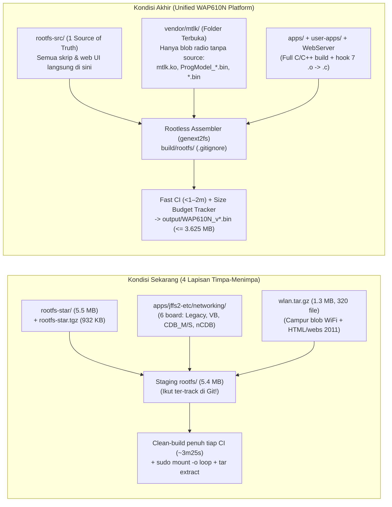

# 📐 Master Modernization & Unification Plan: WAP610N Platform

> **Status Implementasi:** ✅ **Phases 1–6 Selesai Diimplementasikan** (Unified WAP610N Architecture, Zero Opaque Archives, Rootless `genext2fs`, C89 JSON API, Anti-Brick `0x0012` Guard, `packages/` Plugin Framework).
> **Visi Arsitektur Akhir:** **"1 Board (`STR8132 / CNS2132`), 1 Product (`WAP610N`), 1 Source Tree"**  
> Menghapus seluruh warisan sistem timpa-menimpa multi-vendor tahun 2008–2011 menjadi satu repositori tunggal yang bersih, transparan tanpa arsip tersembunyi, cepat di-build, aman terhadap batas **Flash 4 MB (`bootpImage <= 3,801,088 bytes`)** & **RAM 32 MB**, serta siap untuk pengembangan fitur dan teknologi masa depan & easy development.

---

## 📋 Status Keputusan Desain (Terkunci)

Berdasarkan tinjauan teknis codebase dan keputusan pemilik proyek:

1. **Urutan Eksekusi — Phase 0 (Pre-Execution Hardware Verification) Lebih Dulu**:
   * Sebelum perubahan struktur kode Phase 1 dieksekusi, build CI **`44862989442`** (yang sudah memulihkan `webs` baru + `sysmon` + `df -h` + WebUI `20/40 MHz`) akan diuji flash terlebih dahulu di hardware live WAP610N sebagai baseline stabil.
2. **Pemangkasan Produk Total (`Only WAP610N`)**:
   * Repo ini dikhususkan **100% hanya untuk WAP610N**. Seluruh konfigurasi, skrip, dan profil build untuk `WET610N`, `WES610N`, `Legacy`, `CDB_M`, `CDB_S`, `nCDB`, dan `VB-2.3.10` akan dibersihkan secara permanen. *(Catatan: mode operasi nirkabel di dalam WebUI WAP610N tetap berfungsi normal; yang dibuang adalah target produk/board lain).*
3. **Zero Opaque Archives (`vendor/mtlk/` Folder Terbuka)**:
   * Tidak ada lagi pembungkusan arsip `.tar.gz`/`.tgz` (`wlan.tar.gz`, `rootfs-star.tgz`) yang menyembunyikan isi dan memperlambat development. Seluruh file ditempatkan dalam **folder terbuka yang rapi dan transparan di Git** sehingga setiap file, ukuran, dan perubahannya langsung terlihat saat `git status` / `ls`.
4. **Strategi Fitur WPS, `apps/Intel-WPS`, & `apps/wpa_supplicant-0.5`**:
   * **Klarifikasi Fakta Codebase**: Fitur WPS **tidak pernah dipangkas** dari firmware runtime. Alasan `#Intel-WPS` dan `#wpa_supplicant-0.4.10` ter-comment di [`appsconfig/.config`](file:///workspaces/wap610n/boards/star-6.7.2-mtlk-U-Media-vela/appsconfig/.config#L28-L30) hanyalah karena vendor dulu membekukan binary `wsccmd` (`583 KB`), `wpa_supplicant` (`205 KB`), `wpa_cli` (`30 KB`), dan `wpa_passphrase` (`11.5 KB`) ke dalam `wlan.tar.gz`, **padahal source code lengkap C/C++-nya sudah ada di repo** ([`apps/Intel-WPS/`](file:///workspaces/wap610n/apps/Intel-WPS) dan [`apps/wpa_supplicant-0.5/`](file:///workspaces/wap610n/apps/wpa_supplicant-0.5)) dan [`e2fsprogs-1.40.4`](file:///workspaces/wap610n/apps/e2fsprogs-1.40.4/Makefile.MTLK) bahkan sudah meng-compile `libuuid.a` khusus untuk `Intel-WPS`.
   * **Rekomendasi Terbaik (2 Tahap Aman)**:
     * **Phase 1–3**: Pertahankan `wsccmd` & `wpa_supplicant` dari `vendor/mtlk/` agar fitur WPS hardware (tombol fisik **GPIO 13** / `WPS_PBC.sh`) 100% tetap berjalan stabil selama restrukturisasi rootfs & build engine.
     * **Phase 4**: Aktifkan kembali build-from-source `apps/Intel-WPS` (`wsccmd`) dan `apps/wpa_supplicant-0.5`, uji di hardware WAP610N (WPS PushButton + WPA2-PSK), strip binary-nya (`strip`), lalu hapus binary prebuilt-nya dari `vendor/mtlk/`. Dengan begitu, **seluruh daemon WPS & WPA 100% dikompilasi dari source code terbuka** dan bisa di-patch/di-hardening langsung (misal proteksi brute-force PIN / opsi PBC-only).

---

## 🏗️ Arsitektur: Sekarang vs Target Akhir

---

## 🔒 Invarian Hardware & Batas Mutlak (Tidak Boleh Dilanggar di Semua Fase)

Sesuai [`AGENTS.md`](file:///workspaces/wap610n/AGENTS.md):
1. **Toolchain & Dialek C**: Tetap **GCC 3.4.6 (`arm-linux-uclibc-`)**, standar **C89 / GNU89** (jangan pakai fitur C99/C11 di kernel/userspace legacy).
2. **ABI Kernel `2.6.16-star`**: Jangan ubah layout struct header inti (`skbuff.h`, `netdevice.h`, dll.) selama driver wireless proprietary `mtlk.ko` masih berupa binary blob.
3. **Batas Keras Flash (`mtdblock2`)**: `output/bootpImage` & `WAP610N_v*.bin` **WAJIB `<= 3,801,088 bytes` (`3.625 MB` / `0x3A0000`)**. Melebihi 1 byte saja akan merusak partisi config `mtdblock4` (`0x103E0000`).
4. **RAM Footprint (`32 MB`)**: Semua daemon baru harus ringan, di-link ke uClibc, di-strip (`arm-linux-uclibc-strip`), dan file sementara/log wajib di `/tmp` (`tmpfs`), bukan menulis sering ke flash.
5. **Fitur Bawaan Tetap Utuh**: Dual-Band 2.4/5 GHz, WPA2, WPS PushButton (GPIO 13), Hardware Reset (GPIO 3), Power/WPS LEDs (GPIO 0/2), Ethernet PHY RTL8201CP, Dropbear SSH (:22), Telnet (:23), Flash Dumper, dan sysctl memory tuning.

---

## 🗺️ Peta Jalan Multi-Fase (Phase 0 – Phase 6)

### Phase 0 — Baseline Hardware Check (Prasyarat Sebelum Refactor)
**Penanggung Jawab**: User flash + Verifikasi Live SSH  
**Tujuan**: Memastikan build CI terakhir (`44862989442`, commit `2fa94136`) stabil di perangkat keras nyata sebelum kita mulai memindahkan/menghapus file struktur build.

* **Checklist Verifikasi Live**:
  * `/root/mtlk/web/webs` bukan lagi `306,236` byte (Aug 2011), melainkan binary baru hasil compile (`~318 KB`) dengan semua fix keamanan X1–X6, child `_exit(0)` guard, dan upgrade fork reduction.
  * `/bin/sysmon` melaporkan angka `Listen / Established / Close_Wait` sesuai `netstat -an`.
  * `df -h`, `ps` tunggal (`./webs` + `drvhlpr -a eth0`), WebUI `wireless_basic.asp` dropdown `20 MHz / 40 MHz` + runtime apply berjalan normal.
  * Sisa free `CommitLimit` dan log `dmesg` bersih tanpa error.

---

### Phase 1 — Single Source of Truth RootFS & Pembongkaran Arsip
**Tingkat Risiko**: Rendah–Sedang | **Estimasi Perubahan**: Struktur rootfs, packaging, & CI scripts  
**Tujuan**: Menghilangkan sistem timpa-menimpa permanen dan menyingkirkan semua arsip `.tar.gz`/`.tgz`.

#### 1.1 Hapus Duplikasi `rootfs/` & `rootfs-star.tgz`
* **[MODIFY]** [`.gitignore`](file:///workspaces/wap610n/.gitignore): Tambahkan `build/` dan `rootfs/` agar direktori assembly sementara tidak pernah dilacak Git.
* **[DELETE]** `rootfs/` (`5.4 MB`, duplikat manual dari `rootfs-star/`) dari tracking Git (`git rm -r --cached` / `git rm -r rootfs`), serta [`rootfs-star.tgz`](file:///workspaces/wap610n/rootfs-star.tgz) (`932 KB`).
* **[RENAME / UNIFY]** `rootfs-star/` → tetap `rootfs-star/` di Phase 1 (atau rename rapi ke `rootfs-src/` di Phase 2 setelah semua script diperbarui) sebagai **satu-satunya sumber file rootfs**.
* **[MODIFY]** [`docker/compile.sh`](file:///workspaces/wap610n/docker/compile.sh), [`devscripts/validate-build-prerequisites.sh`](file:///workspaces/wap610n/devscripts/validate-build-prerequisites.sh), dan [`.github/workflows/compile.yml`](file:///workspaces/wap610n/.github/workflows/compile.yml): Hapus seluruh referensi/pengecekan `rootfs-star.tgz` & `wlan.tar.gz`; pastikan direktori staging `rootfs/` selalu disalin segar dari `rootfs-star/` tiap build.

#### 1.2 Bongkar `wlan.tar.gz` ke Folder Terbuka `vendor/mtlk/`
Dari audit 320 file di dalam `wlan.tar.gz`:
* **[NEW]** Folder terbuka `vendor/mtlk/` berisi **HANYA komponen tanpa active source build**:
  * `vendor/mtlk/driver/`: `mtlk.ko`, `LICENSE.txt`
  * `vendor/mtlk/images/`: `ap_upper.bin`, `sta_upper.bin`, `contr_lm.bin`, `bootloader.bin`, dan `ProgModel_*.bin`
  * `vendor/mtlk/etc/`: `wsccmd`, `wpa_supplicant`, `drvhlpr`, `wpa_cli`, `mtdump`, `wpa_passphrase`, `mtpriv`, `LICENSE.txt` *(catatan: `wsccmd` & `wpa_supplicant` akan dipindah ke build-from-source di Phase 4!)*
  * `vendor/mtlk/bcl/`: `BclSockServer`, `bcl_util.tcl`, `LICENSE.txt`
* **[DELETE]** [`wlan.tar.gz`](file:///workspaces/wap610n/wlan.tar.gz) (`1.3 MB`) setelah isinya dipilah bersih:
  * **90 file `web/*` lama (`1.15 MB`)** termasuk binary `webs` 2011 (`306 KB`) dibuang total (karena sudah di-compile dari `apps/WebServer` + `rootfs-star/root/mtlk/web/`).
  * **47 skrip/config `.sh`/`.tcl`/`.conf` usang** dibuang total (karena sudah dikelola di `rootfs-star/root/mtlk/`).

#### 1.3 Satukan Skrip `apps/jffs2-etc/networking/VB/`
* **[MOVE]** Pindahkan seluruh skrip & config aktif dari [`apps/jffs2-etc/networking/VB/`](file:///workspaces/wap610n/apps/jffs2-etc/networking/VB) (termasuk 2 file yang sebelumnya hanya ada di `VB/`: `combined_ver_path.tcl` dan `etherdump_awk`) ke satu sumber di `rootfs-star/root/mtlk/etc/` & `rootfs-star/root/mtlk/saved_configs/`.
* **[MODIFY]** [`devscripts/net-ver-mkrootfs.sh`](file:///workspaces/wap610n/devscripts/net-ver-mkrootfs.sh): Ubah menjadi alur **assembly deterministik tanpa saling timpa**:
  1. Staging segar `rootfs/` dari sumber tunggal `rootfs-star/`.
  2. Install seluruh hasil compile (`apps/*`, `gpio.ko`, `apps/WebServer/LINUX/webs`, kernel modules).
  3. Install blob tertutup dari `vendor/mtlk/` (zero file collision!).

#### 1.4 Gerbang Keamanan Phase 1 (Zero Regression Proof)
* Bandingkan daftar penuh file, ukuran, dan permission di dalam `ramdisk_2.6.16.img.lzma` **sebelum** Phase 1 vs **sesudah** Phase 1 menggunakan diff script (`find ... -printf '%p %m %s\n'`). Tidak boleh ada satu pun file runtime yang hilang atau berubah permission secara tidak sengaja.

---

### Phase 2 — "1 Board, 1 Product, 1 Source Code" Cleanup
**Tingkat Risiko**: Rendah | **Tujuan**: Memangkas seluruh kode mati non-WAP610N dan membuat semua konfigurasi terbaca manusia.

#### 2.1 Pangkas Varian Board, Model, & Skrip Purba
* **[DELETE]** Varian board non-WAP610N di [`apps/jffs2-etc/networking/`](file:///workspaces/wap610n/apps/jffs2-etc/networking): `Legacy/`, `CDB_M/`, `CDB_S/`, `nCDB/`, `VB-2.3.10/`, dan skrip tingkat atas yang tidak terpakai; sesuaikan [`apps/jffs2-etc/Makefile.MTLK`](file:///workspaces/wap610n/apps/jffs2-etc/Makefile.MTLK) (atau gabungkan langsung ke step build tunggal).
* **[DELETE]** Profil produk lain: [`config/WET610N_VERSION`](file:///workspaces/wap610n/config/WET610N_VERSION), `default_sta_WES610N.conf`, `default_sta_WET610N.conf`. Sisakan [`config/WAP610N_VERSION`](file:///workspaces/wap610n/config/WAP610N_VERSION) dan konfigurasi WAP610N saja.
* **[DELETE]** Duplikasi & skrip era Subversion/NFS:
  * Hapus duplikat [`devscripts/make_nv.sh`](file:///workspaces/wap610n/devscripts/make_nv.sh) (satukan ke [`make_nv.sh`](file:///workspaces/wap610n/make_nv.sh) / `Makefile`).
  * Bersihkan skrip mati di [`devscripts/`](file:///workspaces/wap610n/devscripts): `checkout_nv.sh`, `mount_nfs.sh`, `umount_nfs.sh`, `rootfs-checkout.sh`, `rootfs-commit.sh`, `rootfs-update.sh`, `umedia-pack.sh`, `umedia-unpack.sh`, `make_platform`, `release-pack.sh`, `release-unpack.sh`, dll.
* **[CHECK]** Evaluasi `apps/` yang kosong/tidak dipakai (`apps/scripts/FILES_UNUSED_IN_MINIMAL` / symlink `l/openssl` legacy di `dolink.sh`), rapikan tanpa menyentuh `apps/Intel-WPS` & `apps/wpa_supplicant-0.5` (karena keduanya dipakai untuk Phase 4!).

#### 2.2 Generate `config.img.gz` Otomatis dari Teks Biasa
Saat ini default partisi konfigurasi flash (`mtdblock4`) disimpan sebagai binary gzip ext2 [`config.img.gz`](file:///workspaces/wap610n/rootfs-star/root/mtlk/etc/config.img.gz) yang tidak bisa di-diff Git.
* **[NEW]** `config/mtdblock4-defaults/` (berisi file plain text `sys.conf`, `wlan0.conf` — otomatis disinkronkan dari `saved_configs/default_ap_WAP610N.conf` & `sys.conf.default`).
* **[MODIFY]** Build script men-generate `config.img.gz` otomatis menggunakan `genext2fs -b 1024 -d ...` + `gzip -9` pada setiap build! Jadi mengubah nilai default factory reset cukup mengedit 1 file teks dan langsung terverifikasi di `git diff`.

#### 2.3 Top-Level Developer `Makefile` yang Modern & Granular
* **[MODIFY]** [`Makefile`](file:///workspaces/wap610n/Makefile): Buat target developer yang intuitif:
  * `make image` — Full build (kernel + apps + webs + ramdisk + `bootpImage` + QA check).
  * `make webs` — Compile & strip hanya `apps/WebServer/LINUX/webs` (< 2 detik).
  * `make apps` — Compile ulang userspace apps tanpa touch kernel.
  * `make kernel` — Compile ulang `zImage` & modules.
  * `make pack` — Rebuild `ramdisk_2.6.16.img.lzma` + `bootpImage` + jalankan [`docker/verify-firmware.sh`](file:///workspaces/wap610n/docker/verify-firmware.sh).
  * `make docker-shell` — Masuk ke shell 32-bit `wap610n-builder` interaktif dengan satu perintah.

---

### Phase 3 — Fast Build Engine, Rootless Packaging & CI Telemetry
**Tingkat Risiko**: Rendah | **Tujuan**: Mempercepat loop CI dari ~3,5 menit menjadi ~1 menit dan membebaskan proses packaging dari `sudo` / `--privileged`.

1. **Rootless Ext2 Ramdisk Packaging ([`devscripts/net-ver-mkrootfs.sh`](file:///workspaces/wap610n/devscripts/net-ver-mkrootfs.sh))**:
   * Jadikan `genext2fs -U -b 12288` + *device table* (`config/rootfs-device-table.txt` untuk `/dev/gpio*`, `/dev/led*`, `/dev/rdflt0`, `/dev/mtd*`, `0600` shadow/dropbear) sebagai metode **utama**, bukan `sudo mount -o loop`.
   * Tidak butuh container `--privileged` saat assembly rootfs dan hasil ramdisk lebih deterministik.
2. **Container & Build Caching di CI ([`.github/workflows/compile.yml`](file:///workspaces/wap610n/.github/workflows/compile.yml))**:
   * Cache image/layer `wap610n-builder` (Debian 8 i386 + Make 3.81) via `actions/cache` atau GHCR agar CI tidak menghabiskan ~50 detik membangun ulang container setiap push.
   * Hilangkan `make clean` kernel yang dipaksakan di [`devscripts/net-ver-select-star.sh`](file:///workspaces/wap610n/devscripts/net-ver-select-star.sh#L53) saat `.config` & `device_id.h` tidak berubah; pertimbangkan `ccache` untuk kernel & `openssl`/`busybox`/`dropbear`.
3. **Flash & RAM Budget Telemetry ([`docker/verify-firmware.sh`](file:///workspaces/wap610n/docker/verify-firmware.sh))**:
   * Cetak ringkasan otomatis di GitHub Actions Summary & console log:
     * Ukuran `zImage` + `ramdisk_2.6.16.img.lzma` + `bootpImage` vs limit `3,801,088 bytes` (**sisa headroom dalam KB**).
     * Top 10 file terbesar di ramdisk (`/root/mtlk/images/ProgModel_*.bin`, `/bin/busybox`, `/root/mtlk/web/webs`, `/lib/*`, dll.).
     * Cek otomatis: zero host hardcoded paths, C89 strictness check untuk file baru, syntax check seluruh `.sh` & `.tcl`, dan integritas marker binary.

---

### Phase 4 — Isolasi & Substitusi Blob Proprietary (7 `.o` WebServer + `Intel-WPS` + `wpa_supplicant` + `mtlk.ko`)
**Tingkat Risiko**: Sedang–Tinggi (bertahap per modul, teruji di hardware)  
**Tujuan**: Menghilangkan ketergantungan pada binary tertutup satu per satu, atau menyediakan *drop-in hook* jika source code eksternal ditemukan.

#### 4.1 Hook Pertukaran 7 `.o` di `apps/WebServer`
Berdasarkan dump simbol ELF (`arm-linux-nm -g --defined-only`):

| Modul `.o` | Ukuran | Simbol Publik | Strategi Penggantian (jika source tidak ketemu) atau Drop-in C (jika source ketemu) |
|---|---|---|---|
| `wireless.o` | `80 KB` | `1`: `formDefineWireless` | **Target #1**: Reimplementasi form handler wireless di C89 (`wireless.c`), sehingga bug lama seperti `IsHTEnabled` vs `ChannelBonding` hilang permanen dari C tanpa hack Tcl! |
| `wps.o` | `17 KB` | `2`: `formDefineWPS`, `wpsPage` | **Target #2**: Mudah diganti ke `wps.c` untuk kendali langsung `mtlk_wps_cmd.tcl` / `/var/wps_*`. |
| `mt_task.o` | `15 KB` | `6`: `MT_PrepareStatisticsTask`, `MT_TaskScheduler`, `websStatisticsHandler`, status array | **Target #3**: Background polling statistik ringan. |
| `mt_validation.o` | `12 KB` | `6`: `MT_ASPreturn`, `MT_DefineValidationFuncs`, `MTretValue`, `isInteger` | **Target #4**: Parser validator parameter berbasis `mt_params.db`. |
| `utils.o` | `22 KB` | `14`: `doSystem`, `submitToFlash`, `lang_init`/`lang_get`, `startWPS_PBC`, `waitRedirectPage`, dll. | **Target #5**: Wrapper shell, i18n `STRINGS_EN.txt`, dan commit config. |
| `mt_api.o` | `96 KB` | `53`: database param `MT_Get_Param`/`MT_Set_Param`, `MT_WriteConfFiles`, `commitToFlash`, link detection | **Target #6**: Reimplementasi parser/writer `wlan0.conf`/`sys.conf` bersih di C89. |
| `hnap_implementation.o` | `179 KB` | `5`: `websHNAPHandler`, `fill_action_list`, `generate_return_msg_header`, `xml_encode`, `report_memory_error` | **Opsional / Cut Candidate**: Hanya dipakai protokol Cisco HNAP1 SOAP. Jika tidak dipakai oleh client modern, bisa diganti stub atau dinonaktifkan (**hemat ~180 KB ukuran ELF / flash!**). |

* **[MODIFY]** [`apps/WebServer/LINUX/Makefile`](file:///workspaces/wap610n/apps/WebServer/LINUX/Makefile): Tambahkan switch per modul (`USE_BLOB_WIRELESS ?= 1`, dst.). Begitu file `<modul>.c` tersedia (hasil pencarian source maupun rewrite C89), set flag ke `0` dan modul langsung di-compile dari `.c`.

#### 4.2 Aktifkan Build-from-Source `apps/Intel-WPS` & `apps/wpa_supplicant-0.5`
* **Langkah A**: Uji kompilasi `apps/wpa_supplicant-0.5` dengan `arm-linux-uclibc-gcc` dan `apps/Intel-WPS` (`wsccmd`, link ke `openssl-0.9.8a` + `e2fsprogs-1.40.4/lib/libuuid.a`) di container `wap610n-builder`.
* **Langkah B**: Strip hasil binary dan bandingkan ukurannya terhadap versi prebuilt (`wsccmd` `583 KB`, `wpa_supplicant` `205 KB`).
* **Langkah C**: Uji **WPA2-PSK**, **WPS PushButton (GPIO 13)**, dan **WPS PIN / client join** di hardware WAP610N. Jika 100% sukses:
  * Aktifkan permanen di `appsconfig/.config` & hapus binary prebuilt `wsccmd`/`wpa_supplicant`/`wpa_cli`/`wpa_passphrase` dari `vendor/mtlk/etc/`.
  * Kini WPS & WPA2 **100% open source**, bisa diperbaiki langsung bila ada kerentanan keamanan (misal lock brute-force PIN WPS atau update cipher handling).

#### 4.3 Drop-in Hook untuk `mtlk.ko` (Jika Source Driver Metalink Ditemukan)
* **[NEW]** `kernel/patches-wap610n/` untuk memisahkan modifikasi kernel kita dari tree kernel `2.6.16-star` asli.
* **[NEW]** Target `make mtlk-driver` di `Makefile` yang siap menunjuk ke tree source `mtlk` (`M=... modules` terhadap `kernel/linux-2.6.16-star`) dan otomatis menggantikan `vendor/mtlk/driver/mtlk.ko` bila source driver tersebut kelak ditemukan.

---

### Phase 5 — Modernisasi Arsitektur Userspace & Optimasi Memori/Flash
**Tingkat Risiko**: Sedang | **Tujuan**: Memangkas overhead CPU 200 MHz / RAM 32 MB dan mengklaim kembali ruang flash yang terbuang.

1. **Audit Ruang Flash (`ProgModel_*.bin` & Web Assets)**:
   * Di hardware nyata, chip radio WAP610N hanya menggunakan subset kecil file kalibrasi `ProgModel_*.bin` (saat ini **156 file** memakan ~2.47 MB uncompressed di tar, ~600–800 KB terkompresi di LZMA). Setelah memverifikasi di hardware revisi chip exact mana yang dimuat `mtlk.ko` (`dmesg`/syslog), file `ProgModel` untuk hardware board asing dapat dipisah ke folder arsip opsional repo (tidak ikut ramdisk jika tidak pernah dimuat, atau pertahankan hanya set yang relevan dengan revisi EEPROM `0x301` / hardware GPB230!).
   * Minifikasi JS/CSS WebUI dan hilangkan file grafis/bahasa mati.
2. **Native JSON Telemetry API di GoAhead (`webs`)**:
   * Alih-alih memanggil `tclsh` + `awk` + `popen()` yang memicu `fork()` berulang di RAM 32 MB, tambahkan handler C langsung (`/api/status.json`, `/api/wifi.json`) yang membaca `/proc/meminfo`, `/proc/net/mtlk/wlan0/Debug/MACStats`, `/proc/net/tcp`, dan `/tmp/udhcpd.leases` secara zero-fork (~1 KB buffer stack).
3. **Self-Healing Watchdog & Config Integrity**:
   * Peningkatan `/bin/sysmon`, log rotation ketat di `/tmp`, dan proteksi agar `config_save.sh` tidak pernah menimpa `mtdblock4` bila file config corrupt/0 byte.

---

### Phase 6 — "Future Breakthrough Ready" Platform (4 MB Flash / 32 MB RAM)
**Tingkat Risiko**: Rendah–Sedang (modular plug-in) | **Tujuan**: Menjadikan WAP610N sebagai platform eksperimen & produksi yang sangat mudah dikembangkan dengan fitur-fitur modern.

1. **Sistem Plugin `packages/` Terstandarisasi**:
   * Pola folder standar `packages/<fitur>/` (`Makefile.pkg` + check C89 + `strip` + auto-install ke rootfs + laporan delta KB otomatis di CI).
2. **Kandidat Inovasi Masa Depan (Memanfaatkan Sisa Headroom Flash & RAM)**:
   * **Modern Mobile-First Web UI**: Antarmuka responsif ringan berbasis `/api/*.json` (HTML5 + CSS/JS kompak < 80 KB terkompresi) yang langsung nyaman dibuka dari smartphone saat Mode Plug & Play.
   * **Smart Wi-Fi Health & Auto-Channel Advisor**: Analisis periodik interferensi (`MACStats` FCS errors / TX retries + `iwlist scan`) untuk menyarankan atau otomatis memilih channel 2.4 / 5 GHz terbersih dan menyesuaikan bandwidth `20 MHz / 40 MHz`.
   * **Safe WebUI Pre-Flash Guard & [`firmware-flasher/`](file:///workspaces/wap610n/firmware-flasher) Parity**: Menanamkan validasi header ARM `0xEA000006`, Device ID `0x0012`, limit `<= 3,801,088` bytes, dan verifikasi CRC32 penuh di `apps/WebServer/upldform.c` *sebelum* proses write ke `mtdblock2` dimulai (anti-brick 100%).
   * **Remote Fleet / Lightweight Telemetry**: Key-only Dropbear SSH provisioning, opsional HTTP/syslog webhook, atau agen monitoring ringan yang muat dalam budget < 256 KB flash & < 512 KB RAM.

---

## ✅ Verification Plan

Setiap fase akan dieksekusi dalam branch/commit terpisah dan **wajib lolos seluruh gerbang verifikasi** sebelum melangkah ke fase berikutnya:

### Automated Checks (CI & Lokal)
1. **Container Build Verification**: Workflow [`.github/workflows/compile.yml`](file:///workspaces/wap610n/.github/workflows/compile.yml) sukses menghasilkan `output/bootpImage` & `output/WAP610N_v*.bin`.
2. **QA Integrity Gate ([`docker/verify-firmware.sh`](file:///workspaces/wap610n/docker/verify-firmware.sh))**:
   * Ukuran `<= 3,801,088 bytes`, ARM branch header `0xEA000006`, Device ID `0x0012`, CRC32 header == footer.
   * Marker compiled `webs` valid (bukan 2011 blob), `dropbear` & `busybox` executable, `0600` `/etc/shadow`, zero backdoor CGI, zero hardcoded host paths.
3. **RootFS Parity Check (Khusus Phase 1 & 2)**:
   * Diff daftar file, symlink, device nodes (`/dev/gpio*`, `/dev/led*`, `/dev/rdflt0`), dan permissions di `ramdisk_2.6.16.img.lzma` sebelum vs sesudah restrukturisasi harus identik (kecuali penghapusan yang memang direncanakan & terdokumentasi).

### Manual Verification (Live Hardware WAP610N)
1. **Boot & Watchdog**: `dmesg` bebas panic/error, LED Power hijau solid, `ps` menunjukkan single `./webs`, tidak ada duplikat daemon/fork leak.
2. **Resource & Storage**: `Committed_AS` tetap aman jauh di bawah `CommitLimit`, `df -h` valid, konfigurasi `/mnt/jffs2` bertahan setelah reboot, factory reset tombol GPIO 3 memulihkan default WAP610N `ChannelBonding = 0`.
3. **Radio, WPS & Akses**: Wi-Fi 2.4 GHz & 5 GHz berfungsi, toggle `20 MHz <-> 40 MHz` via WebUI bekerja live, tombol fisik WPS (`GPIO 13`) berfungsi normal, serta SSH (:22), Telnet (:23), dan `/bin/sysmon` akurat.
