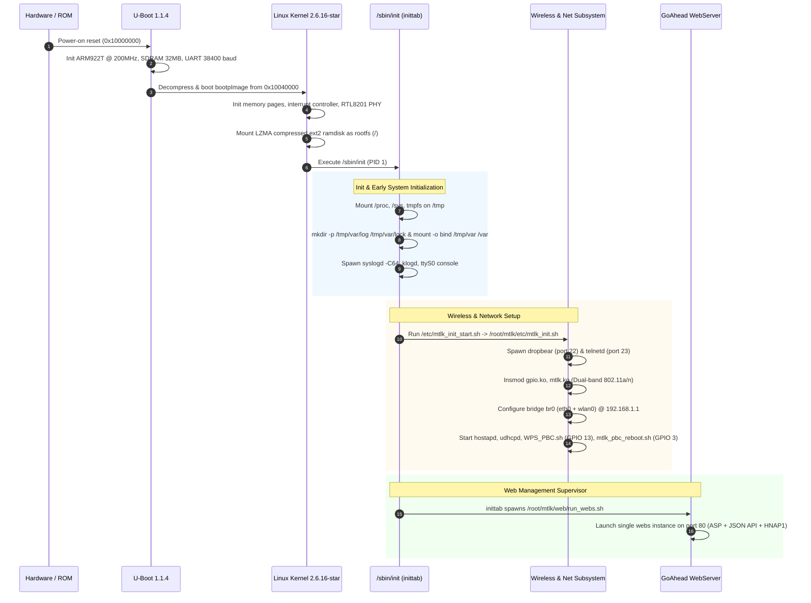

# 🗂️ Single Source of Truth RootFS, Boot Sequence & Live Diagnostics

`rootfs-star/` adalah **satu-satunya sumber kebenaran** untuk seluruh konfigurasi sistem, skrip init, CLI applets, dan aset WebUI WAP610N. Direktori `rootfs/` hanyalah staging sementara yang dibuat saat build dan tidak dilacak oleh Git.

---

## 1. Alur Boot & Arsitektur Daemon



---

## 2. Utilitas CLI & Manajemen ConfigFS (`rootfs-star/bin/`)

- **Diagnostik & Jaringan**: `sysmon` (CPU/mem/TCP via `awk`), `curl`, `json`, `nettest`, `flashdump`, `help`.
- **Manajemen ConfigFS (`mtdblock4`)**:
  - `config_lock.sh` / `config_unlock.sh` — Mutex atomik berbasis `mkdir` untuk mencegah race condition flash.
  - `config_mount.sh` — Memuat `mtdblock4` ke `/tmp/fs.img` lalu mount loopback ke `/mnt/jffs2`.
  - `config_umount.sh` & `config_save.sh` — Memvalidasi `wlan0.conf` & `sys.conf` tidak kosong/corrupt, remount read-only, kompres gzip, verifikasi `<= 128 KB`, dan `simpdiff` sebelum menulis ke `/dev/mtdblock4`.
  - `diag_log.sh` — Logging terpadu ke `/dev/kmsg` dan `syslogd`.

---

## 3. Prosedur Diagnostik Hardware Live (SSH / Telnet)

### A. Capture Baseline Saat Boot
```sh
dmesg
logread 2>/dev/null
ps
ifconfig
cat /proc/meminfo
cat /proc/mtd
netstat -lnt 2>/dev/null
```

### B. Verifikasi GoAhead Web UI & Listener Port 80
```sh
ps | grep -E 'run_webs|/webs|webs$'
ls -l /root/mtlk/web/webs /root/mtlk/web/run_webs.sh
netstat -lnt 2>/dev/null | grep ':80'
wget -q -O - http://127.0.0.1/api/status.json
```

### C. Verifikasi Network, Wireless & Tombol Fisik (GPIO 3 / GPIO 13)
```sh
ifconfig br0; ifconfig wlan0; brctl show 2>/dev/null
lsmod 2>/dev/null
ps | grep -E 'mtlk|wlan|hostapd|udhcpd|upnpd|mtlk_pbc_reboot|WPS_PBC'
ls -l /dev/gpio3 /dev/gpio13 /dev/rdflt0
```

| Gejala | Bukti Utama yang Diperiksa |
|---|---|
| Browser tidak bisa terhubung | Proses `webs`, listener `:80`, IP `br0` (`192.168.1.1`) |
| Web UI muncul lalu mati | Count respawn di `ps`, OOM/segfault di `dmesg` |
| Telnet jalan tapi Wi-Fi mati | `wlan0`, `br0`, `mtlk.ko`, `dmesg \| grep -i mtlk` |
| Setting hilang setelah reboot | Mount `/mnt/jffs2`, log `config_save.sh`/`config_umount.sh`, `/proc/mtd` |
| Tombol WPS tidak merespons | `/dev/gpio13`, proses `WPS_PBC.sh`, lock `/tmp/WPS_PBC_monitor.lock` |

> [!NOTE]
> Jika perlu menyimpan capture sementara, selalu gunakan `/tmp` (`tmpfs`), jangan menulis log berulang kali ke `/mnt/jffs2` (`mtdblock4`).

---

## 4. Ringkasan Audit Stabilitas Runtime & Userspace (`RT-17–RT-21`, `K-11`)

| Kode | Subsistem | Masalah yang Diperbaiki |
|---|---|---|
| **RT-17** | Early Boot (`mtlk_init_start.sh`) | Membaca `Telnet_Enabled` dan `SSH_Enabled` dari `/mnt/jffs2/sys.conf` (default `1`) sebelum menjalankan `telnetd` / `dropbear`. |
| **RT-18** | Config Generator (`mtlk_set_config.tcl` & `management.c`) | Mendaftarkan `SSH_Enabled`, `Telnet_Enabled`, dan `WirelessMgmtEnabled` di `sys.conf`, membersihkan prefix `^`, serta deduplikasi key (mencegah `auto_network_type` ganda). |
| **RT-19** | ConfigFS Sync (`config_umount.sh` & `config_save.sh`) | Menjaga `SSH_Enabled`, `Telnet_Enabled`, dan `WirelessMgmtEnabled` tetap utuh di `/mnt/jffs2/sys.conf` dan `/tmp/sys.conf` pada seluruh pemanggil langsung `config_umount.sh`. |
| **RT-20** | WPS Init (`mtlk_init_wps.sh`) | Fallback `BSSID_USAGE=1`, `WPS_IGNORESELECTEDREGISTRAR=0`, identitas vendor dari `sys.conf`, dan strip `\r` pada `ESSID`/`NW_KEY`. |
| **RT-21** | Runtime Shell & CGI | Quoting variabel kosong (`wps_config_flash.sh`, `mtlk_linkstat_event*.sh`, `wpsCleanTempClock.sh`), operator POSIX `=` (`gui_wps_init.sh`), dan restore host key Dropbear di `remote_access.cgi`. |
| **K-11** | Custom Userspace C Daemons | Zero-fork C I/O untuk `get_config()`/ARP/PID file di `force_ethpc_renew_ip.c`, skip whitespace di `linkUtil.c`, dan pembersihan warning `-Wall` di seluruh utilitas C (`0 warnings`). |
